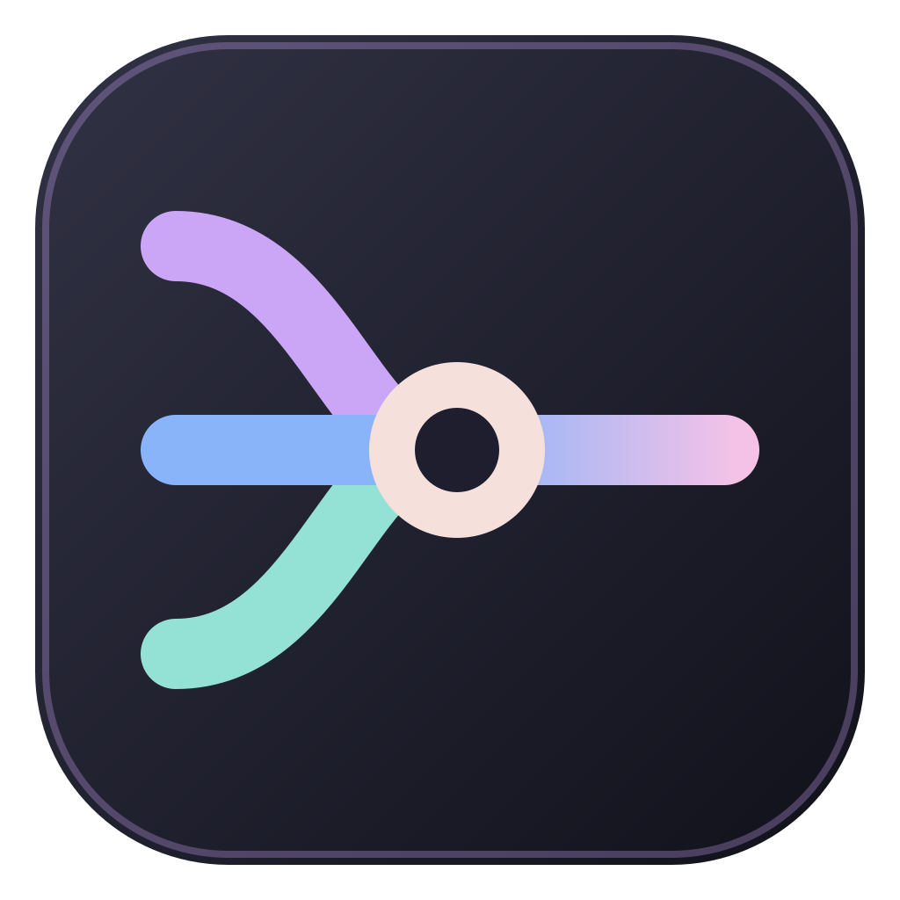
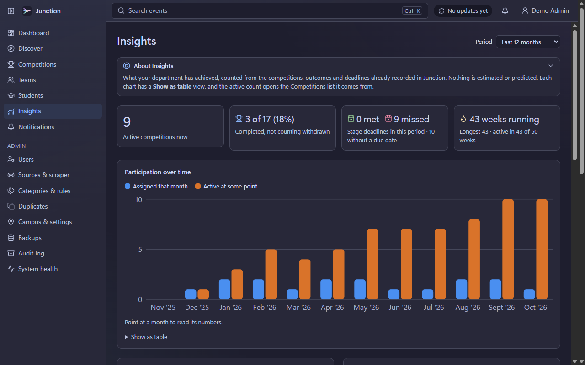
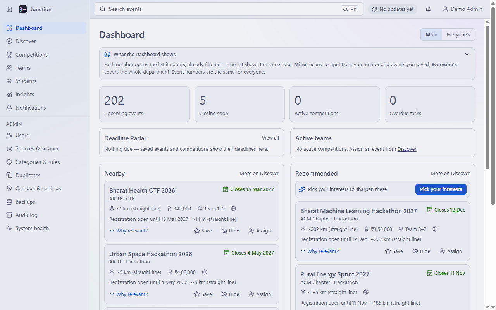

<p align="center">
  
</p>

<h1 align="center">Junction</h1>

<p align="center">
  Find, track and win student competitions — for a whole department, on one Windows PC.
</p>

<p align="center">
  <a href="https://github.com/persxn/junction/releases/latest"><b>Download for Windows</b></a>
  · <a href="#features">Features</a>
  · <a href="#build-from-source">Build from source</a>
  · <a href="LICENSE">MIT licence</a>
</p>

---

Junction is a desktop app for a college department that wants to stop missing hackathons,
CTFs, coding contests and innovation challenges. It gathers events from public sources,
lets professors assign them to students and teams, tracks every deadline and stage, and shows
what the department has actually achieved — all stored locally on one computer, with no
account or server to sign up for.

<p align="center">
  
  
</p>
<p align="center"><sub>Screenshots use synthetic demo data.</sub></p>

## Install

1. Download **`Junction_0.9.0_x64-setup.exe`** from the
   [latest release](https://github.com/persxn/junction/releases/latest).
2. Run it. It installs for your Windows user only — **no administrator rights needed** — and
   adds Junction to the Start menu.
3. Open Junction and follow the first-run setup: your department, the first administrator,
   where data and backups live, and a recovery code.

**Requirements:** Windows 10 (64-bit) or Windows 11, about 150 MB of disk space.

Everything Junction needs ships inside the installer: its own Node.js runtime, the local
database engine, the backend service and the place-name data used for "nearby" distances. The
one Windows component it relies on — the Microsoft Edge **WebView2** runtime, already part of
Windows 11 — is installed automatically if it is missing.

> The installer is not code-signed yet, so Windows SmartScreen may say it "protected your PC".
> Choose **More info → Run anyway**. You can check the download against the SHA-256 published
> with each release.

## Features

- **Discover** — events from CTFtime, CLIST and Devfolio (within each source's published
  limits), plus manual entry and URL import. Featured views for _nearby_, _closing soon_, _new_
  and _recommended_, every recommendation with its reason, and saved searches that alert you to
  new matches.
- **Competitions** — a pipeline from _considering_ to _completed_, team or individual
  assignment in three steps, workflow templates with stages and tasks, progress and schedule
  health, resources, outcomes and results.
- **People** — students (with CSV/XLSX import), teams, mentors, skills and each student's
  competition history.
- **Deadlines** — a Deadline Radar and Dashboard, notifications with snooze, a tray badge and
  Windows toasts for anything critical.
- **Insights** — participation over time, the funnel from considering to completed, outcomes,
  deadlines met vs missed, which sources found the events you took on, and your busiest
  students, teams and mentors. Every number is counted from what is recorded; nothing is
  estimated.
- **Appearance** — Catppuccin Latte, Frappé, Macchiato and Mocha alongside a Classic theme;
  Calm, Standard and Showcase effect levels with RGB presets. Every flavour is contrast-tested,
  Calm loses no information, and Windows' _reduce motion_ setting always wins.
- **Private by design** — one SQLite database on your machine, Argon2id passwords, roles for
  administrators and professors, an audit log, encrypted backups with a recovery code.

## Build from source

| Tool                           | Version                                                |
| ------------------------------ | ------------------------------------------------------ |
| Node.js                        | 24.19.0 (`.node-version`)                              |
| pnpm                           | 12.4.2 (`npm i -g pnpm@12.4.2`)                        |
| Rust                           | 1.98.1, `stable-x86_64-pc-windows-msvc`                |
| Visual Studio Build Tools 2022 | "Desktop development with C++" (MSVC + Windows 11 SDK) |

```sh
pnpm install --frozen-lockfile
pnpm verify                                   # format, lint, typecheck, ~4,600 tests
pnpm --filter @compintel/backend bundle       # the backend the shell starts
pnpm --filter @compintel/desktop tauri:dev    # run the app in development
```

To build the installer:

```sh
pnpm gazetteer:build                          # once: place-name data from GeoNames
pnpm --filter @compintel/desktop release      # → apps/desktop/src-tauri/target/release/bundle/nsis/
```

Development data lives in `%LOCALAPPDATA%\CompIntel-dev`; an installed copy keeps its data in
`%LOCALAPPDATA%\JunctionData` (the program itself installs to `%LOCALAPPDATA%\Junction`). The internal package scope is
still `@compintel/*`, from the project's working name.

## Project layout

```text
apps/backend       Fastify + SQLite service: all business logic, scrapers, jobs
apps/desktop       React UI and the Rust (Tauri 2) shell: window, tray, backend supervision
packages/contracts zod schemas shared by both: DTOs, enums, error codes
tools/             gazetteer builder and performance tooling
resources/         seeds, gazetteer manifest, brand assets
docs/              architecture spec, ADRs, decisions, per-work-package handoffs
```

The design is written down in [`docs/ARCHITECTURE.md`](docs/ARCHITECTURE.md), the decisions
behind it in [`docs/adr/`](docs/adr/), and current status in
[`docs/PROGRESS.md`](docs/PROGRESS.md).

## Licence

Junction is released under the [MIT licence](LICENSE).

It ships third-party work under its own terms: place data from
[GeoNames](https://www.geonames.org/) (CC BY 4.0, see
[`resources/gazetteer/ATTRIBUTION.md`](resources/gazetteer/ATTRIBUTION.md)), the
[Catppuccin](https://catppuccin.com/) palettes (MIT), and the Node.js runtime (MIT; its licence
is installed next to it). Credits are also shown in the app under **About Junction**.
