# Competition Intel — Architecture Specification

**Version:** 1.1.1 · **Date:** 20 Sep 2026 · **Status:** ACCEPTED — implementation baseline (amended after WP-00…WP-02b)
**Author:** Architect (Claude, Cowork session) · **Implementer:** Claude Code (worker session)

> **How to use this document.** This is the implementation source of truth. The worker must not
> deviate silently: any change goes through an ADR in `docs/adr/` and is raised in the WORKER REPORT.
> Items marked **[OPEN]** depend on unresolved questions (§2). Numbers marked *estimate* must be
> verified by the benchmark/perf work packages before they are relied on.
>
> **Priority order for every trade-off:** Reliability > Maintainability > Usability > Performance > Feature count.

### Changelog

| Version | Date | Changes |
|---|---|---|
| 1.0-draft | 20 Sep 2026 | First complete architecture. |
| **1.1** | 20 Sep 2026 | Folded in the WP-01 engineering review and WP-02 source research: new decisions D-26…D-33; user actions U1–U6 (§2.1); SSE over authenticated fetch streams; per-spawn client secret + header names; stdin-EOF orphan detection; Job Object owned by the shell; packaged layout; custom SQL migrations for FTS5/triggers; plain local pre-migration copies; robots Crawl-delay precedence; per-source cadence; PII stripping at the adapter boundary; URL-import restrictions; typo tolerance redefined; EventQuery date/unknown/distance semantics; progress and permission clarifications; roadmap split into smaller WPs and re-scoped (Devpost adapter removed); ADR-0016…0018; rulings index (§21). |
| 1.1.1 | 20 Sep 2026 | Rulings R1–R10 after WP-03a/03b (see §21). |

---

## 0. Product summary

A Windows, local-first **competition intelligence** tool for one university department. A backend
service continuously collects hackathons, ideathons, innovation challenges, CTFs and major coding
contests from approved sources into a local database; professors discover events with fast filters
or plain-English questions answered by a small local LLM; and they manage the student side —
students, teams, mentors, assigned competitions, custom workflows, progress, deadlines and outcomes.

The product is **Discover → Decide → Deliver**, joined by the *assignment*. The value is one trusted
place where "what's out there" meets "who is doing what, by when".

Working name: **Competition Intel** (code/paths: `compintel`).

---

## 1. Resolved decisions

| ID | Decision | Architectural consequence |
|---|---|---|
| D-01 | UI → API → Application services → DB. UI never touches the DB. | Separate backend process; versioned HTTP API; shared contracts package. |
| D-02 | Pilot backend runs on one machine; must be movable to an always-on campus machine without rewrite. | "Host mode" first; "Client mode" later uses the same backend build and API. |
| D-03 | Open department: professors see all students, teams, competitions; only owner/co-mentors edit their teams & workflows; admins full access. | Code-defined RBAC + ownership predicates (§10). |
| D-04 | Students ↔ teams, events, mentors are many-to-many. | Join tables with history (`from/to` timestamps). |
| D-05 | Core app runs on 8 GB RAM, CPU-only. AI targets 16 GB. GPU optional. | LLM in a separate, on-demand process; AI tiers (§5). |
| D-06 | Distance = straight-line from the configured campus, shown "~180 km (straight line)"; filters 50/100/250/500 km/Anywhere. | Offline gazetteer; distance derived at query time. |
| D-07 | Local accounts created by admin; Argon2id; sessions; auto-lock; roles ADMINISTRATOR, PROFESSOR; no SSO in MVP. | `AuthProvider` boundary so SSO can be added later. |
| D-08 | MVP event types: hackathons, ideathons, innovation challenges, CTFs, major coding contests. Recurring rated rounds must not dominate the feed. | `event_series` + `is_recurring_round`; separate Contest Calendar. |
| D-09 | In-person → India only; online → worldwide; hybrid → by physical location. Configurable. | Single geography-policy module (§7.4). |
| D-10 | Sources: Devfolio, Unstop, Devpost, CTFtime, CLIST + manual creation + URL import; college sites via configurable adapters afterwards. ToS/robots check before any scraper; no bypassing. | Adapter framework + compliance gate enforced in code (§7.2). |
| D-11 | AI is read-only in MVP. | Fixed set of read-only tools; actions are Phase 2 with confirmation. |
| D-12 | Files are referenced (paths/URLs), never copied, in MVP. | `resources` table; open allowlist (§13). |
| D-13 | Daily auto backup, keep 14; manual backup/restore; CSV/XLSX export; configurable destination; warnings. | Backup service (§14). |
| D-14 | Close-to-tray (default on, can be disabled); scheduler keeps running; "Exit completely" stops everything. | Tauri tray + backend supervision (§3.2). |
| D-15 | Categories from source tags + deterministic rules; admin edits list; professors override per event. AI classification is Phase 2. | `categories`, `category_rules`, `event_categories.origin`. |
| D-16 | ₹0 budget for paid APIs. | Local LLM, offline geocoding, no paid scraping/search/routing. |
| D-17 | Code signing not mandatory for the pilot unless the environment requires it. | See §18. |
| D-18 | Recommendations are rule-based and explainable ("Why relevant?"). | Deterministic relevance scorer (§8.4). |
| D-19 | Notifications in-app only; rules not implemented until ownership is confirmed. | Schema ready; engine in WP-23 after Q4. |
| D-20 | Primary mentor + co-mentors; admin can transfer ownership with history intact. | Mentor join tables with validity periods; transfer use-case (§10.4). |
| D-21 | Outcomes are part of the competition lifecycle (exact MVP fields open). | `engagement_outcomes`. |
| D-22 | Student data minimization. | Minimal field set; phone disabled by default; erasure path. |
| D-23 | Offline works for everything except scraping, URL import and external links; offline is not a failure. | `SKIPPED_OFFLINE` run outcome; offline banner, not error. |
| D-24 | Audit log for administrative accountability. | Append-only `audit_log` written in the same transaction as each change. |
| D-25 | Light/dark following Windows; accessibility baseline. | Design tokens + system theme sync (§16). |
| D-26 | **Source verdicts (WP-02):** CTFtime APPROVED_WITH_LIMITS (documented API only) · Devfolio APPROVED_WITH_LIMITS (public server-rendered pages only; never `api.devfolio.co`) · CLIST APPROVED_WITH_LIMITS once an account + API key exist · Unstop MANUAL_IMPORT_ONLY until a human reads its Terms · **Devpost MANUAL_IMPORT_ONLY** (its Terms prohibit scraping) · college sites PENDING_REVIEW, approved one by one. | `sources.compliance_status` seeded from this; WP-12/13 re-scoped (§19); ADR-0016. |
| D-27 | **Refresh cadence:** the scheduler runs a 15-minute refresh cycle; each source also has a minimum interval: Devfolio 15 min, Unstop 15 min (if approved), CTFtime 30 min, CLIST 30 min, college sites 12 h. Manual refresh is allowed down to a per-source floor (5 min platforms, 10 min CTFtime/CLIST, 1 h colleges). | `sources.cadence_minutes`, `sources.manual_min_interval_minutes` (§7.2). |
| D-28 | **Politeness:** effective per-host delay = max(3 s default, source setting, robots `Crawl-delay`). TLS validation is never disabled; a 403/WAF response is recorded as BLOCKED and never retried with another User-Agent. | PoliteHttpClient rules (§7.2). |
| D-29 | **PII never enters the database from sources:** `EventCandidate` has no fields for people; adapters drop participant, judge and contact data; e-mail addresses and phone numbers in descriptions are redacted at ingest. | Adapter boundary + normalization tests (§7.3). |
| D-30 | **URL import** (user-initiated, one page) works for approved sources and for domains not in the `sources` table; it is **refused for MANUAL_IMPORT_ONLY/BLOCKED domains** (e.g. Devpost), which get the manual form with the link attached. | WP-14 behaviour (§7.1). |
| D-31 | Non-technical competition types (case, quiz, marketing, cultural) are out of MVP scope (per D-08); an event-type policy stores them as POLICY_HIDDEN. | Type policy next to the geography policy (§7.4). |
| D-32 | **Attribution & reuse:** every event shows its source(s) with links; CTFtime and CLIST are credited in About; source data is never republished outside the app and never used to train models. | UI + policy (§7.2). |
| D-33 | **Real student data only on machines with disk encryption.** The build machine (Windows 11 Home, no BitLocker) uses synthetic data only. | Seeds/synthetic data generator; health check (§14). |

---

## 2. Open questions

| # | Question | Blocks | Proposed default (used until answered) |
|---|---|---|---|
| Q1 | Pilot host: one shared PC or individual professor machines? Is off-campus access required? | Client mode (post-M5); network security | Host mode on one machine. No off-campus access in MVP (later via university VPN — never exposed to the internet). |
| Q2 | Pilot facts: date, number of professors, host machine specs, who installs, IT restrictions (Smart App Control, WDAC/AppLocker, proxy), who maintains scrapers. **Partly answered:** the build machine is Windows 11 Home, Ryzen 7 5700, 16 GB, RTX 4060 8 GB (GPU tier), SAC was ON, no BitLocker. The pilot host is still unknown — check it for Smart App Control and disk encryption. | WP-26 model choice, WP-31 packaging | Build-machine facts until the pilot host is known. |
| Q3 | Campus name and coordinates. | WP-07 setup wizard (entered at runtime — not blocking code) | — |
| Q4 | Notification recipients and thresholds. | WP-23 | Competition/stage/task deadlines → primary + co-mentors; watched-event changes → users who saved it; saved-search matches → owner; scraper/backup failures → admins. Thresholds 7 / 3 / 1 days + due day + overdue. |
| Q5 | Permission defaults in §10 (student profile edits, event corrections, co-mentor rights). | WP-07, WP-17, WP-19 | As in the §10 matrix. |
| Q6 | Can teams include students from other colleges? (Other departments are already allowed.) | WP-17/18 | Supported in the data model (`is_external`); UI behind an admin setting, off by default. |
| Q7 | Outcome fields in MVP. | WP-21 | Team-level: result, rank, prize text, certificate reference, result URL, notes. |
| Q8 | Student personal fields & consent; does the university have a data-protection policy/officer? | WP-17 | Fields as in §6.2; phone off by default; record "privacy notice acknowledged" date. |
| Q9 | Audit log retention and visibility. | WP-30 | Admins see all; professors see activity timelines of records they can view; retain 3 years (login events 1 year). |
| Q10 | Does university IT have a code-signing certificate or signing service? Will the project be open source? **More important after WP-01:** Smart App Control was ON on the build machine, so a pilot host may have it on too — then either IT turns it off or everything we ship must be signed. | WP-31 | Unsigned internal pilot if Smart App Control/WDAC allow (§18). |
| Q11 | University identity provider (Google Workspace / Microsoft 365). | Post-MVP SSO | — |
| Q12 | Hybrid events whose physical venue is outside India: show as "online participation possible" or hide? | WP-08 | Show, labelled "Hybrid — online participation" (configurable). |
| Q13 | ~~Sources whose ToS forbid automated access~~ **RESOLVED → D-26, D-30:** manual entry only, plus an optional permission request. | — | — |

### 2.1 User actions (outside the codebase)

| # | Action | Blocks | Status |
|---|---|---|---|
| U1 | Turn **Smart App Control off** on the build machine (Windows Security → App & browser control → Smart App Control → Off). Every Rust/Tauri build creates new unsigned executables, which SAC blocks. Defender antivirus stays on; since the April 2026 update SAC can be turned back on later. | WP-03a and every build after it | OPEN |
| U2 | Approve the toolchain installs (Visual Studio Build Tools C++ workload ~6–8 GB, rustup + stable Rust ~2 GB, pnpm) and **enable Windows long paths** (admin, one registry value + restart). | WP-03a | OPEN |
| U3 | Read Unstop's Terms (<https://unstop.com/legal/terms-of-use>) in a browser; search for "scrap", "crawl", "robot", "automat", "spider", "extract", "data mining"; paste any matching clauses to the architect. | Unstop adapter (WP-13) | OPEN |
| U4 | Create a free CLIST account and API key (keep it private; it is entered in the app's settings later, or as `COMPINTEL_CLIST_API_KEY` for development). | Live CLIST runs (WP-11) | OPEN |
| U5 | Optional: send the permission e-mails in `docs/research/permission-request-template.md` (Devfolio courtesy note; Devpost permission request), ideally from a university address. | Nothing (Devpost stays manual unless permission arrives) | OPEN |
| U6 | Optional: Defender exclusions for build folders (admin; speeds builds, slightly lowers protection). Default: no exclusions. | Nothing | OPEN |

---

## 3. System architecture

### 3.1 Deployment modes

- **Host mode (MVP / pilot).** One Windows machine runs the desktop shell, backend and (optionally)
  the LLM. Professors and admins sign in with app accounts; they may share the machine.
- **Client mode (post-MVP, when Q1 requires it).** Desktop apps on professor laptops connect to a
  backend on a campus machine over the LAN with TLS. The backend is the same build, run as a Windows
  service or on a tray host. The only UI change is configuration (server URL + certificate pinning).
  The API reports its version; the UI refuses to run against an incompatible major version.
- **Future.** The backend can serve the same React UI to browsers; `department_id` scoping already
  exists in the schema for multi-department use.

### 3.2 Process model (host mode)

```text
┌──────────────────────────────── Windows machine ─────────────────────────────────┐
│                                                                                  │
│  compintel.exe  (Tauri 2 shell, Rust — thin)                                      │
│   ├─ Window: WebView2 ── React UI ───── HTTP/JSON + SSE ─────┐                    │
│   ├─ Tray icon & menu, single-instance, optional autostart   │ 127.0.0.1:<port>  │
│   └─ Supervisor: spawn / health-check / restart backend      │ + client secret   │
│                                                              ▼                    │
│  node.exe  backend  (Fastify, TypeScript)                                         │
│   ├─ API layer: routing, validation, authentication, error mapping                │
│   ├─ Application services: events, sources, search, students, teams,              │
│   │  engagements, workflows, deadlines, notifications, ai, backup, audit, system  │
│   ├─ Job runner ──► Scraper engine ──► source adapters ──────────────► Internet    │
│   ├─ SQLite (WAL) data\app.db  +  FTS5 search index                               │
│   └─ LLM supervisor ── HTTP ──► llama-server.exe (on demand, 127.0.0.1)           │
│                                  └─ models\<model>.gguf                           │
│   (rare, transient) headless Microsoft Edge via Playwright for JS-only sources    │
└──────────────────────────────────────────────────────────────────────────────────┘
```

**Rules**

1. Only the backend touches the database, the network (scraping) and the LLM.
2. The UI talks to the backend only through `/api/v1`. Tauri IPC is used **only** for shell concerns:
   window/tray, open an external URL, pick a local file path, check whether a local path exists,
   reveal a file in Explorer.
3. The backend never depends on the shell: `node backend/main.js --data-dir <dir>` runs it
   standalone. This is how server mode and integration tests run.

**Lifecycle**

- Shell start → the shell spawns the backend with `std::process::Command` (not the shell plugin's
  sidecar API, so it controls the Job Object) and env `COMPINTEL_DATA_DIR`, `COMPINTEL_CLIENT_SECRET`
  (32 random bytes, **new for every backend spawn**, including restarts), `PORT=0` → backend binds
  `127.0.0.1` on a free port → prints one JSON line
  `{"ready":true,"port":N,"apiVersion":"1.x","appVersion":"..."}` on stdout → the Tauri command
  `backend_connection()` returns `{baseUrl, clientSecret, generation}` to the UI → UI loads.
- Every request from the UI carries `X-CompIntel-Client: <clientSecret>` and, after login,
  `Authorization: Bearer <sessionToken>`. On a network error the UI calls `backend_connection()` again
  (the generation number tells it the backend restarted); sessions live in the DB, so they survive a
  backend restart.
- Backend crash → shell restarts it with exponential backoff (1 s, 2 s, 4 s … max 60 s). After 5
  crashes in 10 minutes the UI shows *"The background service stopped"* with **Open logs**,
  **Copy diagnostics**, **Retry**.
- Window close → hide to tray (if enabled). **Exit completely** → `POST /api/v1/system/shutdown`
  (finish current transaction, cancel scrapes, stop llama-server) → wait ≤ 10 s → kill process tree.
  The shell places children in a Windows **Job Object** so they die if the shell dies.
- Orphan protection: the shell keeps the backend's **stdin pipe** open; the backend exits gracefully
  when stdin reaches EOF (the shell died). The Job Object (`JOB_OBJECT_LIMIT_KILL_ON_JOB_CLOSE`,
  created by the shell with the `windows` crate — Tauri has no built-in kill-tree) is the hard
  guarantee; `llama-server` and any headless Edge inherit the job because the backend spawns them.
- **Verify early (WP-05):** WebView2 can call the loopback API. CORS allowlist: `http://tauri.localhost`
  (production; `useHttpsScheme` stays false) and `http://localhost:5173` (Vite dev server, `strictPort`).
  Host-header allowlist: `127.0.0.1:<port>` and `localhost:<port>`. Run the test once with
  `--enable-features=LocalNetworkAccessChecks,msWebViewAllowLocalNetworkAccessChecks` (Chromium Local
  Network Access is flag-gated in WebView2 today but may become default). Fallback: route API calls
  through Tauri's HTTP plugin.

**Packaged layout (Windows)**

```text
<install dir>\
├─ CompIntel.exe                      Tauri shell
└─ resources\
   ├─ node\node.exe                   official signed Node 24 LTS
   ├─ backend\main.mjs                esbuild bundle
   ├─ backend\native\                better-sqlite3 + argon2 prebuilds (.node)
   ├─ backend\migrations\*.sql
   ├─ backend\seeds\                  institutions, categories, rules, workflow templates
   ├─ gazetteer.db
   └─ llama\cpu\ · llama\vulkan\       llama-server.exe + DLLs (optional CUDA build downloaded later)
```

Backend command: `resources\node\node.exe resources\backend\main.mjs --data-dir <dir>`. Binaries are
shipped as Tauri `resources`, not `externalBin`, and WP-31 verifies that an upgrade replaces every
binary (hash check).

### 3.3 Layering

```text
React UI ──► typed API client (types from packages/contracts)
   │ HTTP
Routes (Fastify)          parse + validate (zod), authenticate, map errors → problem+json
   │
Application services      use-cases, authorization (policy), transactions, audit entries
   │
Domain logic (pure)       normalization, dedup scoring, progress, relevance, query DSL, geo
   │
Repositories / clients    Drizzle queries, SearchIndex, LlmClient, PoliteHttpClient
   │
SQLite · llama-server · Internet
```

- Domain logic is pure functions (no I/O) → exhaustively unit-tested.
- Authorization is enforced in application services through one `policy` module — never only in
  routes or the UI.
- Every mutating use-case writes its audit entry in the same DB transaction.
- Long CPU work (dedup sweeps, large imports) runs off the request path (job runner or
  `worker_threads`).

### 3.4 Repository layout

```text
competition-intel/
├─ apps/
│  ├─ backend/                 Fastify service — all business logic
│  │  ├─ src/modules/<module>/ routes.ts · service.ts · repo.ts · domain/*.ts · *.test.ts
│  │  ├─ src/platform/         db, http-client, logger, config, jobs, errors, llm
│  │  ├─ migrations/           SQL migrations (drizzle-kit), committed
│  │  └─ test/fixtures/        recorded source responses, seed data
│  └─ desktop/
│     ├─ src/                  React UI (features/<area>/…, components/ui/…)
│     └─ src-tauri/            Rust shell (thin)
├─ packages/
│  └─ contracts/               zod schemas: API DTOs, EventQuery DSL, enums, error codes, permissions
├─ tools/                      ai-eval harness, perf data generator, scripts
├─ resources/                  gazetteer build script, institutions seed, category seed rules, workflow templates
└─ docs/                       ARCHITECTURE.md · DECISIONS.md · adr/ · handoff/ · research/ · requirements/
```

Backend modules: `auth`, `users`, `org` (university, departments, campus, settings), `sources`
(adapters, ingestion), `events`, `search`, `students`, `teams`, `engagements`, `workflows`,
`deadlines`, `notifications`, `ai`, `backup`, `audit`, `system` (health, diagnostics, shutdown).

---
## 4. Technology choices

### 4.0 Summary

| Concern | Choice | Main alternative considered |
|---|---|---|
| Desktop shell | **Tauri 2** (Rust, WebView2) | Electron; WinUI 3 / WPF (.NET) |
| UI | **React 19 + TypeScript + Vite**, Tailwind CSS v4, Radix primitives (shadcn/ui), TanStack Query/Router/Table/Virtual, cmdk | Svelte / Solid |
| Backend | **Node.js 24 LTS + Fastify 5**, TypeScript strict | Python + FastAPI; ASP.NET Core |
| API | **REST/JSON `/api/v1`**, OpenAPI 3.1 generated from zod, **SSE** for push, RFC 9457 errors | tRPC; GraphQL |
| Database | **SQLite 3 (WAL)** via better-sqlite3, owned by one backend process | PostgreSQL; node:sqlite |
| ORM / data layer | **Drizzle ORM** + drizzle-kit SQL migrations | Kysely; Prisma |
| Search | **SQLite FTS5** (porter + trigram) + structured SQL filters + deterministic ranking | Meilisearch/Typesense; sqlite-vec embeddings |
| Scraping | **undici** behind a PoliteHttpClient, **cheerio**, JSON-LD extraction, **chrono-node**; **Playwright → installed Edge** only when unavoidable | Python Scrapy; Crawlee |
| Scheduler | **DB-backed in-process job runner** (custom, small) | croner/node-cron; Windows Task Scheduler; BullMQ |
| LLM runtime | **llama.cpp `llama-server`** sidecar (pinned release), JSON-schema constrained output | node-llama-cpp in-process; Ollama; ONNX Runtime GenAI / Foundry Local |
| Model | **2–4B instruct, GGUF Q4_K_M, permissive license**; tiered (§4.11) | 7–9B class (GPU tier only) |
| Auth | **Local accounts, Argon2id (@node-rs/argon2), opaque hashed sessions, code-defined RBAC** | Windows identity; SSO (later) |
| Packaging | **Tauri NSIS installer, per-user**, ships official `node.exe` + llama.cpp CPU build; model downloaded/side-loaded | MSIX; single-binary backend (pkg/SEA) |
| Logging | **pino** JSON → daily rotated files, redaction; diagnostics bundle | winston; Windows Event Log |
| Testing | **Vitest**, fastify.inject, undici MockAgent + recorded fixtures, fast-check, **Playwright** E2E, AI eval harness, perf test | Jest |
| Backup | **SQLite online backup → gzip → `age` encryption** (public-key, passphrase-protected recovery) | DPAPI-bound key; unencrypted |
| Geocoding | **Offline GeoNames gazetteer + curated institutions list** | Nominatim (online, rate-limited) |

### 4.1 Desktop shell — Tauri 2

- **Why:** the backend must be a separate process anyway (server mode, tray scraping), so the shell
  only needs window, tray, supervision and installer. Tauri does this with a small footprint using
  the WebView2 runtime already present on Windows 10/11, and has built-in tray, single-instance,
  autostart, notifications, updater and NSIS per-user installers.
- **Resources:** shell ~20–40 MB RAM; WebView2 processes ~100–200 MB (*estimate*).
- **Main downside:** needs the Rust + MSVC toolchain to build; WebView2 is evergreen (version varies
  per machine, cannot be pinned); fewer published examples of sidecar supervision than Electron.
- **Alternatives:** *Electron* — most mature, but bundles Chromium and its own Node (≈ +100–200 MB
  RAM, ~100 MB installer) and its Node ABI differs from the standalone backend's (two native-module
  builds). *WinUI 3/WPF* — native and light, but no reusable web UI for future browser access and a
  slower path to a polished custom UI.

### 4.2 UI — React + TypeScript

- **Stack:** React 19, Vite, Tailwind CSS v4 with design tokens, Radix primitives via shadcn/ui
  (owned component code), TanStack Query (server state + SSE-driven invalidation), TanStack Router
  (typed routes), TanStack Table + Virtual (large lists), cmdk (Ctrl+K), react-hook-form + zod
  (schemas shared with the backend), Motion (sparingly), Lucide icons, date-fns(-tz).
- **Why:** accessible, keyboard-first primitives; one validation source; fast virtualized lists;
  mature ecosystem the worker is highly productive in.
- **Resources:** bundle target < 1.5 MB gzipped; no cost beyond the WebView.
- **Main downside:** ecosystem churn → pin versions, justify every dependency.
- **Alternative:** Svelte/Solid — lighter, but thinner ecosystem for accessible primitives and tables.

### 4.3 Backend — Node.js 24 LTS + Fastify 5 (TypeScript)

- **Why:** one language end-to-end → shared types for DTOs, the AI query DSL, enums and validation.
  Fastify is mature, schema-first, fast, with built-in pino logging and hooks for auth. The Node
  ecosystem covers scraping (undici, cheerio, chrono-node, robots-parser). Runs identically in host
  and server mode. We ship the official, signed `node.exe` → deterministic native-module ABI.
- **Resources:** ~60–120 MB idle; 200–350 MB during scrape bursts (*estimate*).
- **Main downside:** native addons (better-sqlite3, argon2) need prebuilt binaries per Node version
  → pin Node; CPU-heavy work must stay off the request path.
- **Alternatives:** *Python/FastAPI* — excellent scraping/date libraries, but a second language,
  weaker shared typing with the UI, and PyInstaller-style packaging often triggers antivirus.
  *ASP.NET Core* — robust and light, but splits language from the UI.

### 4.4 API mechanism

- REST/JSON over HTTP, prefix `/api/v1`; OpenAPI 3.1 generated from zod (fastify-type-provider-zod).
- **SSE** stream `/api/v1/stream` for live updates (scrape progress, notifications, cache
  invalidation). The browser `EventSource` API cannot send headers, so the UI reads the stream with
  `fetch()` + `ReadableStream` (a small in-house client, ~100 lines, with reconnect/backoff and
  `Last-Event-ID`), sending the same `X-CompIntel-Client` and `Authorization` headers as every other
  request. No tokens in URLs, no cookies.
- Errors: RFC 9457 `application/problem+json` with a stable `code` (e.g. `SOURCE_UNREACHABLE`),
  human `title`, optional `hint` and `retryable`.
- Cursor pagination; optimistic concurrency via `version` on editable aggregates → `409 CONFLICT`
  with a friendly "someone else changed this" message.
- **Why:** survives the move to a LAN server unchanged; usable by future web/mobile clients.
- **Downside:** more boilerplate than Tauri IPC/tRPC. **Alternatives:** tRPC (TS-only coupling),
  GraphQL (overkill), gRPC (poor browser support).

### 4.5 Database — SQLite (WAL) via better-sqlite3

- **Why:** embedded, zero administration, single file, trivial online backups, very fast at this
  scale (≤ 100k events, ≤ 10k students), FTS5 full-text search built in, JSON functions,
  user-defined functions (haversine). Single-writer is fine because exactly one backend process
  writes; tens of concurrent users through the API are well within limits.
- **Resources:** DB ~20–100 MB per year (*estimate*); page cache capped at 32–64 MB.
- **Main downside:** single host/single writer. **Never place the DB on a network share** (SMB locking
  → corruption). Multi-campus scale would need PostgreSQL.
- **Alternatives:** *PostgreSQL* — needs a service install and administration; overkill for the
  pilot. *node:sqlite* — release-candidate status in 2026; revisit later to drop a native addon.
- **Portability rule:** keep SQL dialect-neutral outside the `search` module; Drizzle supports
  PostgreSQL, so a future migration is a contained project.

### 4.6 ORM / data layer — Drizzle

- Drizzle schema in TypeScript; drizzle-kit generates SQL migrations committed to git (reviewable).
- Repositories per module; raw SQL only via the `sql` tagged template (parameterized).
- Migrations are forward-only; migration tests run from an empty DB and from the previous release's
  fixture DB and assert that FTS tables and triggers exist.
- **Drizzle can't model FTS5 virtual tables or triggers:** those are **custom SQL migrations**
  (`drizzle-kit generate --custom`). `drizzle-kit push` is never used (no script for it).
- Before applying pending migrations to a non-empty DB, the backend makes a **plain local copy**
  (`VACUUM INTO <data>\backups-local\pre-migration-<timestamp>.db`, keep the last 5). It stays on the
  same disk as the DB, so it adds no exposure and needs no encryption keys. Encrypted exports (§14) are
  for AUTO/MANUAL backups to external destinations.
- Pin exact versions (Drizzle is still 0.x).
- **Downside:** younger than Prisma/TypeORM; complex queries sometimes clearer in raw SQL.
- **Alternatives:** Kysely (excellent builder, hand-written migrations); Prisma (heavier, less control
  over SQLite specifics such as FTS5 and triggers).

### 4.7 Search — FTS5 + structured filters (no vector DB in MVP)

- See §8. **Why:** covers every listed filter plus keyword and fuzzy search with zero extra services.
- **Resources:** FTS indexes add roughly 30–60% to the events table size (a few MB to tens of MB);
  queries run in-process in milliseconds.
- **Downside:** no semantic similarity ("climate" ≠ "sustainability") unless aliased or categorized.
- **Alternatives:** Meilisearch/Typesense (extra service to run); sqlite-vec + small CPU embedding
  model — Phase 2 only if the AI eval shows recall gaps.

### 4.8 Scraping stack

- `PoliteHttpClient` over undici: robots.txt (robots-parser, cached 24 h), per-host rate limiting,
  retries with exponential backoff + jitter honouring `Retry-After`, timeouts (connect 10 s, total
  30 s), conditional GET (ETag/Last-Modified), response size cap (5 MB), identifying User-Agent,
  system proxy support.
- Parsing: JSON first (APIs, embedded `__NEXT_DATA__`-style page data); RSS/Atom feeds (many
  WordPress/Drupal campus sites expose `/feed`); cheerio for HTML with per-site selectors; schema.org
  `Event` JSON-LD/Open Graph as a generic fallback for URL import (WP-02 found **no** Event JSON-LD on
  117 Indian campus sites, so it is not a primary strategy); chrono-node plus source-specific rules for
  dates; zod validation of each adapter's output.
- TLS certificate validation is never disabled; invalid certificates, DNS failures and 403/WAF
  responses are recorded as failures (`NETWORK`/`BLOCKED`) and shown in Source status.
- JS-only pages: `playwright-core` driving the **installed Microsoft Edge** (`channel: 'msedge'`,
  headless) — no Chromium download; opt-in per adapter; one browser at a time; closed after use.
- **Resources:** HTTP runs: tens of MB. Browser runs: +250–400 MB transient (*estimate*).
- **Downside:** HTML adapters break when sites change → fixture tests + health monitoring + pause on
  `SCHEMA_CHANGED`.
- **Alternatives:** Scrapy (second runtime); Crawlee (heavier than needed).

### 4.9 Scheduler — DB-backed job runner

- `job_state` rows: `last_run_at`, `last_success_at`, `next_due_at`, `running_since`,
  `consecutive_failures`, `backoff_until`. A 30-second tick runs jobs whose `next_due_at ≤ now` →
  restarts and sleep/resume catch up automatically, with no timer drift.
- Per-job single-flight; global limits (2 concurrent scrapes, 1 LLM job); jitter; stale-lock recovery.
- Offline detection before scraping → runs recorded as `SKIPPED_OFFLINE` (not failures).
- Jobs: `scrape:<source>` (15-minute refresh cycle; each source has its own minimum interval, D-27), `detail-refresh` (changed items
  only), `deadline-evaluator` (5 min), `saved-search-evaluator` (after scrapes), `backup:daily`
  (configured time; runs at next opportunity if missed), `cleanup` (daily), `health-snapshot` (hourly).
- **Downside:** custom code (~200–300 lines) to maintain — heavily tested.
- **Alternatives:** croner/node-cron (in-memory, no state or catch-up); Windows Task Scheduler
  (external, harder to package and observe); BullMQ (needs Redis).

### 4.10 LLM runtime — llama.cpp `llama-server` sidecar

- Uses GGUF quantized models, OpenAI-compatible chat endpoint, **JSON-schema constrained output**
  (grammar-enforced), **prompt-prefix KV caching** (static system prompt + schemas processed once).
- Builds: CPU (AVX2) default; Vulkan (any GPU) or CUDA (NVIDIA) optional, chosen by a first-run
  micro-benchmark. Pin one llama.cpp release; upgrade deliberately via ADR.
- **LLM supervisor** in the backend: lazy start on first AI request; memory guard (won't load unless
  free RAM ≥ model requirement + 1 GB — otherwise deterministic mode with an explanation); idle
  unload after 10 min (5 min on hosts < 12 GB); health checks; crash isolation (an LLM crash never
  affects scraping or the API).
- **JSON-schema constraints can fail open** in some llama.cpp releases (a grammar error yields
  unconstrained output with 200 OK). Therefore: every plan is zod-validated; planner schemas avoid regex
  `pattern`s and use closed objects and enums; a startup self-test checks that the pinned release
  enforces a known schema; per-model chat-template checks are part of WP-26.
- **Downside:** fast-moving upstream; Windows binaries are unsigned (§18); one more process.
- **Alternatives:** *node-llama-cpp* in-process (a native crash/OOM would kill the backend);
  *Ollama* (separate install/service, less control); *ONNX Runtime GenAI / Foundry Local* (NPU
  support is attractive on Copilot+ PCs; narrower model catalog — revisit in Phase 2).

### 4.11 Model selection (class, not a fixed model)

- Class: **2–4B instruction-tuned**, permissive license (Apache-2.0/MIT), GGUF **Q4_K_M**, strong
  JSON/tool-calling, "thinking" mode **off** for query planning.
- Candidates to benchmark in WP-26 (the landscape moves monthly; decide on measured data):
  - 8 GB CPU tier: ~2B class (e.g. Qwen3.5-2B) — or AI off.
  - 16 GB CPU tier: ~3–4B class (e.g. Qwen3.5-4B, IBM Granite 4.x ~3B, Phi-4-mini 3.8B).
  - GPU tier (NVIDIA ≥ 6–8 GB VRAM): 4B fully offloaded, or ~8–9B class (e.g. Qwen3.5-9B).
  - Note: Gemma 4 E4B is ~8B raw parameters (~5 GB Q4 file, ~6.5 GB RAM) → GPU tier only.
- Model registry (config): `id, file, sha256, sizeBytes, contextLength, chatTemplate, tier, license`.
  Download on demand from Hugging Face with checksum verification and resume, or side-load a `.gguf`
  from USB/share (for restricted campus networks).
- **Why small is enough:** the LLM only *plans* a structured query; the database answers it. With
  constrained decoding, a deterministic pre-parser and good examples, a small model is sufficient;
  bigger models mostly add latency.

### 4.12 Authentication

- Local accounts; **Argon2id** via `@node-rs/argon2` (prebuilt, no compiler), minimum m = 19 MiB,
  t = 2, p = 1, tuned to ~250–500 ms on the host.
- Opaque 256-bit session tokens, stored **hashed** (SHA-256); idle auto-lock (default 15 min,
  configurable) and absolute expiry (12 h). UI keeps the token in memory only.
- Login throttling and temporary lockout (5 failures → 5 min, exponential).
- Admin creates accounts; forced password change on first login; admin resets professor passwords.
- First-run wizard creates the first admin and a one-time **recovery code** for admin lockout.
- Host mode: every request also carries the per-spawn client secret in `X-CompIntel-Client`
  (defence in depth, §3.2). Session token: `Authorization: Bearer <token>`.
- **Downside:** no self-service reset (no email in MVP). **Alternatives:** Windows identity (breaks
  on shared PCs/accounts); SSO (needs internet + IT registration → later, behind `AuthProvider`).

### 4.13 Packaging & installer

- Tauri bundler → **NSIS installer, per-user install** (no admin rights), WebView2 bootstrapper
  (installs only if missing).
- Bundle: shell exe, UI assets, official `node.exe` (pinned LTS), backend bundle (esbuild single file
  + native modules folder), `llama-server` CPU build (+ optional Vulkan build), gazetteer DB, seeds —
  layout in §3.2. **Not bundled:** the model (downloaded or side-loaded).
- Data directory: default `%LOCALAPPDATA%\CompIntel\`; configurable at setup for a host machine
  (e.g. `D:\CompIntel\`). Layout: `data\app.db`, `snapshots\`, `models\`, `logs\`, `tmp\`.
  Uninstall keeps data unless the user explicitly opts in.
- Updates: manual installer for the pilot; Tauri updater (Ed25519-signed manifests, free) in Phase 2.
- **Downside:** installer ~120–200 MB (*estimate*) because of node + llama.cpp.
- **Alternatives:** MSIX (requires signing; sandboxing complicates child processes and data dirs);
  single-binary backend via pkg/SEA (packed executables attract antivirus false positives).

### 4.14 Logging & diagnostics

- pino JSON logs → daily rotated files (keep 14 days) in `logs\`; correlation by request id and
  job/run id; **redaction** of passwords, tokens, emails, phone numbers, API keys.
- Shell logs (tauri-plugin-log) to the same folder; UI errors posted to `/api/v1/system/client-log`
  (no session needed because errors can happen before login, but the client-secret header is required;
  body ≤ 8 KB; rate limit 30/min).
- Admin log viewer (filterable tail).
- **Copy diagnostics** → zip of redacted logs, versions, config without secrets, source status and DB
  statistics (no student data). Also the easiest thing to paste back to the architect.

### 4.15 Testing

- **Stack:** Vitest (unit + integration against a real temporary SQLite file), `fastify.inject` for API
  tests, undici `MockAgent` + recorded fixtures for adapters, fast-check for property tests
  (dates, dedup), Playwright for UI end-to-end, a custom AI eval harness, a perf data generator.
- **Why:** one fast, ESM-native runner for backend, contracts and UI logic; real SQLite catches
  migration and FTS issues that mocks would hide.
- **Resources:** full `pnpm verify` target < 2 min on the dev machine; E2E and AI eval run on demand.
- **Downside:** Playwright E2E runs against the web build, not the packaged Tauri app → a short manual
  smoke checklist per release covers the shell.
- **Alternative:** Jest (slower, ESM friction). Details in §17.

### 4.16 Backup

- SQLite online backup + age encryption — full design, rationale, downside and alternatives in §14.
- **Resources:** a backup of a 50 MB DB takes seconds and ~10–20 MB compressed (*estimate*).

### 4.17 Geocoding — offline

- GeoNames cities (India towns/cities + world cities > 15k population; CC BY 4.0, attribution in
  About) packaged as a read-only `gazetteer.db`; curated **institutions** seed (IITs, NITs, IIITs,
  major universities: coordinates, aliases, web domains), admin-editable.
- Resolution order: source coordinates → institution match → city + state → city → unknown.
  Store `geo_precision`; users can correct a location (override, audited).
- Nominatim (usage policy ≤ 1 req/s) is an optional fallback for URL imports only, off by default.

---

## 5. Resource estimates

*All numbers are estimates to be verified in WP-26 (LLM benchmark) and WP-15 (perf test).*

| | **8 GB, CPU only** | **16 GB, CPU only** | **16 GB+, NVIDIA GPU** |
|---|---|---|---|
| UI (Tauri + WebView2) | 120–200 MB | same | same |
| Backend idle / scraping | 60–120 / 200–350 MB | same | same |
| Headless Edge (JS-only sources, transient) | +250–400 MB | same | same |
| LLM when loaded | ~2B Q4: 1.5–2.5 GB — or AI off | ~3–4B Q4: 3–4.5 GB | 4B on GPU: 3–4 GB VRAM + ~1 GB RAM; 8–9B Q4: 6–8 GB VRAM |
| App total, AI off / on | 0.3–0.6 GB / 2–3 GB | 0.3–0.6 GB / 3.5–5 GB | 0.3–0.6 GB / 1.5–2 GB RAM + VRAM |
| AI planning latency (prompt prefix cached) | ~5–15 s | ~3–8 s | ~0.5–2 s |
| On-demand event summary (≈1.5k-token input) | 20–60 s (discouraged) | 10–30 s | 2–5 s |
| Disk — application | 150–250 MB | same | + 0.5–1 GB if CUDA build |
| Disk — model | 1–1.5 GB | 2.5–3 GB | 2.5–6 GB |
| Disk — data per year | DB 20–100 MB; snapshots capped 300 MB; logs ~50 MB | same | same |
| Disk — backups | 14 × compressed DB (typically 5–40 MB each) | same | same |
| CPU | idle ≈ 0; scrape bursts of seconds every 15 min | same | same |

**Rules for 8 GB machines:** AI is off by default when total RAM < 12 GB (admin may enable the 2B
tier); the model loads only on demand and unloads after 5 idle minutes; one headless browser at a
time; SQLite cache capped. Deterministic "smart search" (§9 step 1) works on every tier.

**Test hardware reality (WP-00):** the build machine is the GPU tier (16 GB, RTX 4060) on Windows 11
Home, which has no Hyper-V. Performance tests run there with **halved budgets** as a proxy (§8.3), and
the 8 GB CPU-only experience is validated before the pilot on a real 8 GB laptop or a VirtualBox VM
limited to 8 GB (WP-31/32).

**Server-mode note:** the LLM runs where the backend runs. In client mode professor laptops only run
the UI (~200 MB); the backend host should be a 16 GB machine (ideally with a GPU).

---
## 6. Data model

### 6.1 Conventions

- **Primary keys:** UUIDv7 stored as TEXT — sortable and globally unique (safe for future
  multi-department merges or sync). Generated by a small in-house function (RFC 9562 layout,
  monotonic within a millisecond, unit-tested); no dependency.
- **Timestamps:** INTEGER Unix milliseconds, UTC. Display in `Asia/Kolkata` (setting). Event dates also
  store `timezone` (IANA) and a precision (`DATETIME | DATE | MONTH | UNKNOWN`).
- **Money:** integer minor units + ISO 4217 currency. **Unknown is NULL, never 0.**
- **Unknown ≠ false:** fee, team size and eligibility keep an explicit "unknown" state.
- People and teams are deactivated/archived, not deleted. Hard delete only for a privacy erasure
  (admin, audited).
- `department_id` on department-owned rows (users, teams, engagements, workflow templates, saved
  searches). Events, sources, categories and institutions are global.
- `version INTEGER` on editable aggregates for optimistic concurrency.
- `created_at`, `updated_at`, `created_by` wherever meaningful.
- Enums are TEXT with CHECK constraints; the canonical enum lists live in `packages/contracts`.

### 6.2 Entities

Notation: **PK** primary key · **FK** foreign key · **UQ** unique · `?` nullable.

#### Organization & configuration
| Table | Key columns |
|---|---|
| `organizations` | id PK, name, short_name |
| `departments` | id PK, organization_id FK, name, code, is_managing (true for the configured department; other departments exist as reference entries for students' home departments) |
| `campuses` | id PK, organization_id FK, name, lat, lon, is_primary (one primary per organization), updated_by |
| `settings` | key PK, value_json, updated_by, updated_at — typed registry in code (geography policy, backup config, auto-lock minutes, AI tier, feature flags, source API keys\*) |

\*Source API keys (e.g. CLIST) are low-value but never logged or exported.

#### Identity & access
| Table | Key columns |
|---|---|
| `users` | id PK, department_id FK, email UQ (login), display_name, password_hash, status (ACTIVE\|DISABLED), must_change_password, failed_login_count, locked_until?, last_login_at?, created_at, created_by?, version |
| `roles` | id PK, key UQ (ADMINISTRATOR\|PROFESSOR), name — seeded |
| `user_roles` | user_id FK, role_id FK, PK(user_id, role_id) — a professor can also be an admin |
| `professor_profiles` | user_id PK/FK, designation?, notes? |
| `user_interest_tags` | user_id FK, tag_id FK, PK(both) — for relevance/recommendations |
| `sessions` | id PK, user_id FK, token_hash UQ, created_at, last_seen_at, idle_expires_at, absolute_expires_at, revoked_at?, client_kind (DESKTOP\|WEB), client_label? |

Permissions are defined in code (`packages/contracts/permissions.ts` + backend `policy`), not in the
DB — see §10.

#### Taxonomy
| Table | Key columns |
|---|---|
| `categories` | id PK, name UQ, slug UQ, parent_id? FK, description?, color_token, icon?, sort_order, is_active, created_by |
| `category_rules` | id PK, category_id FK, kind (KEYWORD\|PHRASE\|REGEX\|SOURCE_TAG\|EVENT_TYPE), pattern, fields (TITLE\|DESCRIPTION\|TAGS\|ALL), weight, is_active |
| `tags` | id PK, kind (SKILL\|TECHNOLOGY\|THEME\|INTEREST), name, normalized, aliases_json; UQ(kind, normalized) |
| `search_aliases` | term PK, expansions_json — admin-editable synonyms (ML ↔ machine learning, GenAI ↔ generative AI, CTF ↔ capture the flag) |

#### Places
| Table | Key columns |
|---|---|
| `institutions` | id PK, name, short_name, kind (IIT\|NIT\|IIIT\|CENTRAL_UNIV\|STATE_UNIV\|PRIVATE_UNIV\|COLLEGE\|RESEARCH\|OTHER), city, state, country_code, lat, lon, website_domain?, aliases_json |
| *(gazetteer.db)* `places` | id, name, ascii_name, alt_names, admin1, country_code, lat, lon, population — read-only, shipped with the app, not backed up |

#### Sources & ingestion
| Table | Key columns |
|---|---|
| `sources` | id PK, key UQ, name, adapter (CTFTIME_API\|CLIST_API\|DEVPOST\|DEVFOLIO\|UNSTOP\|CONFIGURED_LISTING\|MANUAL\|URL_IMPORT), config_json, is_enabled, cadence_minutes, manual_min_interval_minutes, min_delay_ms, max_requests_per_run, allowed_paths_json, attribution_text?, trust_rank, compliance_status (APPROVED\|APPROVED_WITH_LIMITS\|MANUAL_IMPORT_ONLY\|PENDING_REVIEW\|BLOCKED), compliance_notes, compliance_reviewed_at?, compliance_reviewed_by?, version |
| `source_state` | source_id PK/FK, last_run_at?, last_success_at?, next_due_at, consecutive_failures, backoff_until?, last_error_kind?, last_error_message? |
| `scrape_runs` | id PK, source_id FK, trigger (SCHEDULE\|MANUAL\|STARTUP_CATCHUP), started_at, finished_at?, outcome (SUCCESS\|PARTIAL\|FAILED\|SKIPPED_OFFLINE\|SKIPPED_BACKOFF\|BLOCKED_BY_POLICY), error_kind? (NETWORK\|DNS\|TLS\|TIMEOUT\|HTTP_4XX\|HTTP_5XX\|BLOCKED\|RATE_LIMITED\|ROBOTS_DISALLOWED\|PARSE\|SCHEMA_CHANGED\|UNKNOWN), error_detail?, listing_complete (bool, §7.6), requests_made, items_seen, items_new, items_updated, items_unchanged, items_invalid, duration_ms |
| `source_records` | id PK, source_id FK, external_key, UQ(source_id, external_key), url, first_seen_at, last_seen_at, last_fetched_at, content_hash, payload_json (validated `EventCandidate`), raw_snapshot_ref?, parse_warnings_json, presence (LISTED\|MISSING\|GONE), missing_since?, event_id? FK, match_method (URL\|AUTO_SCORE\|MANUAL\|NEW), match_score? |

#### Events
| Table | Key columns |
|---|---|
| `event_series` | id PK, name, organizer_name?, recurrence (NONE\|WEEKLY\|BIWEEKLY\|MONTHLY\|YEARLY\|IRREGULAR), is_rated_contest — groups yearly editions and recurring contest rounds |
| `events` | see column groups below |
| `event_deadlines` | id PK, event_id FK, kind (REGISTRATION\|ABSTRACT\|IDEA_SUBMISSION\|PPT\|PROTOTYPE\|FINAL_SUBMISSION\|ROUND\|RESULT\|OTHER), label, due_at, precision, origin (SOURCE\|MANUAL), source_record_id? |
| `event_field_claims` | id PK, event_id FK, field, value_json, source_record_id FK, observed_at, is_selected — every source's value for every field (provenance, disagreement detection) |
| `event_overrides` | id PK, event_id FK, field, value_json, reason, set_by FK, set_at, cleared_at? — manual corrections beat scraped values and survive re-scrapes |
| `event_changes` | id PK, event_id FK, field, old_value_json, new_value_json, cause (SCRAPE\|OVERRIDE\|MERGE\|UNMERGE\|MANUAL), source_record_id?, changed_by?, detected_at — data change history; drives "deadline changed" notifications |
| `event_categories` | event_id FK, category_id FK, PK(both), origin (SOURCE_TAG\|RULE\|MANUAL\|AI), rule_id?, confidence, is_suppressed (manual removal wins over rules), assigned_by?, assigned_at |
| `event_tags` | event_id FK, tag_id FK, PK(both), origin |
| `dedup_candidates` | id PK, event_id_a FK, event_id_b FK, score, features_json, status (PENDING\|MERGED\|REJECTED), decided_by?, decided_at? |
| `event_user_state` | user_id FK, event_id FK, PK(both), is_hidden, hidden_reason?, seen_at? |
| `watchlist_items` | user_id FK, event_id FK, PK(both), note?, added_at |
| `saved_searches` | id PK, user_id FK, department_id FK, name, query_json (EventQuery), notify_on_new, last_evaluated_at?, last_result_hash?, created_at |
| `event_ai_summaries` | event_id FK, model_id, description_hash, summary_md, created_at; PK(event_id, model_id, description_hash) — cache |
| `event_fts`, `event_fts_trigram` | FTS5 external-content tables maintained by triggers (§8) |

**`events` columns**

| Group | Columns |
|---|---|
| Identity | id PK, title, normalized_title, edition_year?, series_id? FK, event_type (HACKATHON\|IDEATHON\|INNOVATION_CHALLENGE\|CTF\|CODING_CONTEST\|OTHER), is_recurring_round |
| Organizer | organizer_name?, organizer_kind (CORPORATE\|IIT\|NIT\|IIIT\|UNIVERSITY\|COLLEGE\|GOVERNMENT\|COMMUNITY\|PLATFORM\|OTHER\|UNKNOWN), host_institution_id? FK |
| Content | summary? (plain text ≤ 500 chars), description_md? (sanitized), prize_text?, prize_total_minor?, prize_currency?, eligibility_text?, eligibility_json? (flags with confidence: levels UG/PG/PhD, gender-specific, India-only, institution restrictions, year restrictions), requirements_text?, submission_requirements_text? |
| Format & place | mode (ONLINE\|OFFLINE\|HYBRID\|UNKNOWN), venue_name?, city?, state?, country_code?, lat?, lon?, geo_precision (EXACT\|INSTITUTION\|CITY\|STATE\|COUNTRY\|UNKNOWN) |
| Dates | timezone?, registration_opens_at?, registration_deadline_at?, registration_deadline_precision, starts_at?, ends_at?, submission_deadline_at?, date_precision |
| Team & fee | team_min?, team_max?, fee_known, fee_minor?, fee_currency?, fee_text? |
| Links | official_url?, registration_url? |
| State | cancellation (NONE\|CANCELLED\|POSTPONED), cancellation_origin? (SOURCE\|MANUAL), visibility (VISIBLE\|POLICY_HIDDEN\|ADMIN_HIDDEN\|MERGED), merged_into_event_id? FK, policy_reason? |
| Quality | quality_score (0–100), has_conflicts, last_verified_at?, last_changed_at, first_seen_at |
| Audit | created_at, updated_at, version |
| Indexes | registration_deadline_at · starts_at · event_type · mode · country_code · (lat, lon) · visibility · series_id · normalized_title |

#### People
| Table | Key columns |
|---|---|
| `students` | id PK, organization_id FK, university_id (roll/enrolment no.), UQ(organization_id, university_id), full_name, preferred_name?, institutional_email?, phone? (disabled by default), home_department_id FK, program (BTECH\|MTECH\|BSC\|MSC\|BCA\|MCA\|PHD\|OTHER), branch?, graduation_year?, is_external, external_institution?, status (ACTIVE\|INACTIVE\|ALUMNI), notes? (short, no sensitive data), privacy_notice_ack_at?, created_at, created_by, version |
| `student_tags` | student_id FK, tag_id FK, relation (SKILL\|INTEREST), proficiency? (1–3), PK(all three) |
| `student_achievements` | id PK, student_id FK, title, event_name?, year?, result?, url?, notes? — history from before the app; in-app outcomes come from competitions automatically |
| `mentorships` | id PK, mentor_user_id FK, student_id FK, started_at, ended_at?, note? — a professor's "my students"; many-to-many |

#### Teams
| Table | Key columns |
|---|---|
| `teams` | id PK, department_id FK, name, description?, status (ACTIVE\|ARCHIVED), created_at, created_by, version; UQ(department_id, name) among active teams |
| `team_members` | id PK, team_id FK, student_id FK, role_label? ("Backend"), is_lead, joined_at, left_at?; one active membership per (team, student) |
| `team_mentors` | id PK, team_id FK, user_id FK, role (PRIMARY\|CO_MENTOR), from_at, to_at?; exactly one active PRIMARY (partial unique index) |

#### Competitions (table `engagements`, UI label "Competition")
| Table | Key columns |
|---|---|
| `engagements` | id PK, department_id FK, event_id FK, participant_kind (TEAM\|INDIVIDUAL), team_id? FK, status (CONSIDERING\|ASSIGNED\|APPLIED\|PARTICIPATING\|COMPLETED\|WITHDRAWN\|NOT_SELECTED), status_changed_at, internal_notes?, created_at, created_by, version; UQ(event_id, team_id) when team_id set |
| `engagement_participants` | engagement_id FK, student_id FK, PK(both), event_id FK (denormalized from the engagement), role_label?, added_at, removed_at? — roster frozen per competition, so later team changes don't rewrite history. **UQ(event_id, student_id) among active rows**: a student can't be in two active competitions for the same event (team or individual) |
| `engagement_mentors` | id PK, engagement_id FK, user_id FK, role (PRIMARY\|CO_MENTOR), from_at, to_at?; one active PRIMARY |
| `engagement_status_history` | id PK, engagement_id FK, from_status?, to_status, changed_by, changed_at, note? |
| `engagement_outcomes` | engagement_id PK/FK, result (PARTICIPATED\|DID_NOT_PARTICIPATE\|QUALIFIED\|FINALIST\|RUNNER_UP\|WINNER\|OTHER), rank?, prize_text?, prize_minor?, prize_currency?, certificate_resource_id? FK, result_url?, notes?, feedback?, recorded_by, recorded_at — **[OPEN Q7]** |

Pipeline mapping: *Discovered* = event exists · *Saved* = `watchlist_items` · *Being considered* →
*Completed* = `engagements.status`.

#### Workflows
| Table | Key columns |
|---|---|
| `workflow_templates` | id PK, department_id FK, name, description?, applies_to_event_type?, is_default_for_type, version_no, is_archived, created_by |
| `workflow_template_stages` | id PK, template_id FK, position, name, description?, weight (default 1), due_rule_json? (e.g. `{"anchor":"REGISTRATION_DEADLINE","offsetDays":-2}`), default_tasks_json |
| `workflows` | id PK, engagement_id FK UQ, template_id? FK, template_version_no?, created_at — copied at assignment; later template edits don't alter existing workflows |
| `workflow_stages` | id PK, workflow_id FK, position (REAL, cheap reorder), name, description?, weight, status (NOT_STARTED\|IN_PROGRESS\|COMPLETED\|BLOCKED\|SKIPPED), blocked_reason?, due_at?, started_at?, completed_at?, completed_by?, progress_override? (0–100), notes?, version |
| `stage_assignees` | stage_id FK, student_id FK, PK(both) |
| `tasks` | id PK, stage_id FK, position, title, is_done, done_at?, done_by?, assignee_student_id?, due_at?, notes? — checklist items that drive stage progress |
| `resources` | id PK, owner_kind (ENGAGEMENT\|STAGE\|TASK\|OUTCOME), owner_id, kind (URL\|GITHUB\|CLOUD_DOC\|LOCAL_PATH\|OTHER), label, uri, machine_label? (for LOCAL_PATH), last_checked_at?, check_status (OK\|MISSING\|UNREACHABLE\|UNCHECKED), added_by, added_at |

#### Notifications
| Table | Key columns |
|---|---|
| `notifications` | id PK, user_id FK (recipient), type, severity (INFO\|WARNING\|CRITICAL), title, body, subject_kind?, subject_id?, route? (in-app link), dedupe_key, UQ(user_id, dedupe_key), created_at, read_at?, snoozed_until?, dismissed_at? |
| `notification_preferences` | user_id FK, type, is_enabled, thresholds_json, PK(user_id, type) — **[OPEN Q4]** |

#### Audit & system
| Table | Key columns |
|---|---|
| `audit_log` | id PK, occurred_at, actor_kind (USER\|SYSTEM\|SCHEDULER\|AI), actor_user_id?, action (dotted, e.g. `team.member.added`), entity_kind, entity_id, summary (human-readable), diff_json (changed fields only, PII-minimized), request_id?, prev_hash, hash — append-only: SQLite triggers reject UPDATE/DELETE; hash chain gives tamper evidence |
| `job_state` | job_key PK, last_run_at?, last_success_at?, next_due_at, running_since?, consecutive_failures, backoff_until? |
| `backup_runs` | id PK, kind (AUTO\|MANUAL\|PRE_MIGRATION\|PRE_RESTORE), started_at, finished_at?, status, destination, file_name, size_bytes?, sha256?, schema_version, error?, verified_at? |
| `ai_query_log` | id PK, user_id FK, query_text, intent?, dsl_json?, result_count, latency_ms, model_id?, used_fallback, feedback? (UP\|DOWN), created_at — kept 30 days; admin can disable; feeds the eval set |
| `__drizzle_migrations` | managed by drizzle-kit |

### 6.3 Entity-relationship diagram (core)

```mermaid
erDiagram
  DEPARTMENTS ||--o{ USERS : "employs"
  USERS ||--o{ USER_ROLES : "has"
  ROLES ||--o{ USER_ROLES : "grants"
  USERS ||--o| PROFESSOR_PROFILES : "may have"
  USERS ||--o{ SESSIONS : "opens"
  DEPARTMENTS ||--o{ STUDENTS : "home of"
  USERS ||--o{ MENTORSHIPS : "mentors"
  STUDENTS ||--o{ MENTORSHIPS : "mentored in"
  STUDENTS ||--o{ STUDENT_TAGS : "has"
  TAGS ||--o{ STUDENT_TAGS : "labels"
  TEAMS ||--o{ TEAM_MEMBERS : "has"
  STUDENTS ||--o{ TEAM_MEMBERS : "joins"
  TEAMS ||--o{ TEAM_MENTORS : "mentored by"
  USERS ||--o{ TEAM_MENTORS : "mentors"
  SOURCES ||--o{ SOURCE_RECORDS : "yields"
  SOURCES ||--o{ SCRAPE_RUNS : "logs"
  EVENTS ||--o{ SOURCE_RECORDS : "backed by"
  EVENTS ||--o{ EVENT_FIELD_CLAIMS : "claimed values"
  EVENTS ||--o{ EVENT_OVERRIDES : "corrected by"
  EVENTS ||--o{ EVENT_DEADLINES : "has"
  EVENTS ||--o{ EVENT_CHANGES : "history"
  EVENTS ||--o{ EVENT_CATEGORIES : "classified"
  CATEGORIES ||--o{ EVENT_CATEGORIES : "groups"
  CATEGORIES ||--o{ CATEGORY_RULES : "matched by"
  EVENT_SERIES ||--o{ EVENTS : "editions / rounds"
  INSTITUTIONS ||--o{ EVENTS : "hosts"
  EVENTS ||--o{ ENGAGEMENTS : "tracked as"
  TEAMS ||--o{ ENGAGEMENTS : "enters"
  ENGAGEMENTS ||--o{ ENGAGEMENT_PARTICIPANTS : "roster"
  STUDENTS ||--o{ ENGAGEMENT_PARTICIPANTS : "participates"
  ENGAGEMENTS ||--o{ ENGAGEMENT_MENTORS : "mentored by"
  USERS ||--o{ ENGAGEMENT_MENTORS : "mentors"
  ENGAGEMENTS ||--o| ENGAGEMENT_OUTCOMES : "result"
  ENGAGEMENTS ||--o| WORKFLOWS : "follows"
  WORKFLOW_TEMPLATES ||--o{ WORKFLOW_TEMPLATE_STAGES : "defines"
  WORKFLOW_TEMPLATES ||--o{ WORKFLOWS : "copied into"
  WORKFLOWS ||--o{ WORKFLOW_STAGES : "has"
  WORKFLOW_STAGES ||--o{ TASKS : "contains"
  WORKFLOW_STAGES ||--o{ STAGE_ASSIGNEES : "assigned"
  STUDENTS ||--o{ STAGE_ASSIGNEES : "works on"
  USERS ||--o{ WATCHLIST_ITEMS : "saves"
  EVENTS ||--o{ WATCHLIST_ITEMS : "saved in"
  USERS ||--o{ SAVED_SEARCHES : "owns"
  USERS ||--o{ NOTIFICATIONS : "receives"
  USERS ||--o{ AUDIT_LOG : "performs"
```



### 6.4 Derived values (computed, not stored)

| Value | Rule |
|---|---|
| Distance from campus | Haversine from event lat/lon to the primary campus, at query time |
| Registration state | NOT_OPEN · OPEN · CLOSING_SOON (≤ 7 days) · CLOSED · UNKNOWN — from dates + now |
| Event phase | UPCOMING · ONGOING · ENDED — from dates |
| Urgency band | TODAY · ≤ 3 DAYS · ≤ 7 DAYS · LATER · PAST |
| Overdue | `due_at < now` and not completed (a badge, not a status) |
| Student year of study | From graduation_year and program length |
| Progress % and schedule health | §11 |
| "Free" | `fee_known AND fee_minor = 0` — unknown fee never matches "free" |
| Source freshness | From `source_state.last_success_at` |

### 6.5 Changes versus the original field list

- **Distance from university** → derived (the campus is configurable).
- **Event status** → split into derived registration state and phase + stored explicit cancellation
  + per-source presence ("not seen at source since …").
- **Sources / source URLs / last scraped** → `source_records` (one row per source listing), not arrays.
- **Skills / technologies / themes** → one `tags` table with kinds, shared with students.
- **Registration fee / prize** → amount + currency + known flag, plus the original text.
- **Eligibility** → original text + structured flags with confidence; never silently inferred.
- **Added:** edition year, series, host institution, timezone and date precision, geo precision,
  field claims (provenance), overrides, change history, quality score, cancellation origin.
- **Student "year"** → `graduation_year` (doesn't go stale). **Previous competitions** → derived
  from competitions + `student_achievements`.

---
## 7. Event ingestion pipeline

```text
job runner ─► adapter.listing() ─► detail() only if new/changed ─► normalize ─► validate (zod)
   ─► geography policy ─► geocode ─► classify (source tags + rules) ─► match / dedup
   ─► merge (field resolution) ─► diff → event_changes ─► saved-search + notification triggers
   ─► FTS index update (triggers)
```

Each item is processed in its own transaction. One bad item never fails a run — it is counted in
`items_invalid` with warnings. A run is `PARTIAL` when some items or pages failed.

### 7.1 Adapter contract

```ts
interface SourceAdapter {
  key: string;                         // 'ctftime'
  displayName: string;
  kind: 'API' | 'JSON_ENDPOINT' | 'HTML' | 'CONFIGURED' | 'MANUAL';
  needsBrowser: boolean;               // true → Playwright/Edge path (rare)
  defaultCadenceMinutes: number;
  listing(ctx: AdapterContext): AsyncIterable<ListingItem>;          // cheap, paginated
  detail?(ctx: AdapterContext, item: ListingItem): Promise<RawDetail>;
  normalize(input: ListingItem | RawDetail, nctx: NormalizeContext): EventCandidate; // pure
}

interface AdapterContext {
  http: PoliteHttpClient;              // the only network access an adapter has
  log: Logger;
  now(): Date;
  signal: AbortSignal;
  config: unknown;                     // validated per adapter
}
```

- `EventCandidate` (zod, in `packages/contracts`) is the common internal schema. Every uncertain field
  carries a confidence and the original text (dates, fees, team size, eligibility).
- Adapters never touch the DB. They are tested with recorded fixtures
  (`test/fixtures/<source>/<case>.(json|html)` → expected candidates as golden files).
- **URL import (WP-14)** first checks the URL's domain: if it belongs to an approved source, that
  adapter's `detail()` + `normalize()` handle it; if the domain is MANUAL_IMPORT_ONLY/BLOCKED (e.g.
  Devpost), no request is made and the manual form opens with the link attached (D-30); otherwise a
  generic single-page extractor (Open Graph, JSON-LD, heuristics) runs once, robots-checked, and the
  professor reviews every field before saving.
- **Adding a source** = one adapter file + fixtures + a `sources` row. The `CONFIGURED_LISTING`
  adapter needs only a row whose `config_json` holds a listing URL plus item/field selectors or regexes,
  or an RSS/Atom feed URL (`"feed": "<url>"`). Admins add college sites from the UI with a **Test extraction** preview.

### 7.2 Compliance & politeness gate (enforced in code)

- A source runs only if `compliance_status ∈ {APPROVED, APPROVED_WITH_LIMITS}` (seeded from the WP-02
  verdicts, D-26, with notes and reviewer). Requests are limited to the source's `allowed_paths_json`.
- robots.txt fetched and cached 24 h **per host** (Devfolio hackathons live on their own subdomains);
  disallowed path → outcome `ROBOTS_DISALLOWED`, no request made.
- **Effective per-host delay = max(3 s, `sources.min_delay_ms`, robots `Crawl-delay`)** (D-28); max
  requests per run (`max_requests_per_run`); max 1 concurrent request per host.
- Honours 429/503 and `Retry-After`. Consecutive failures → backoff between runs
  (15 → 30 → 60 min … max 12 h).
- Identifies itself: `User-Agent: CompIntel/<version> (+mailto:<scraper.contactEmail>)`. The setting
  `scraper.contactEmail` is required by the setup wizard; **no scraping runs before setup is complete.**
- **Never:** log in, solve or bypass CAPTCHAs or anti-bot systems, rotate IPs or user agents, disable
  TLS validation, use credentials other than a documented API key, call undocumented private APIs, or
  ignore a ToS prohibition.
- Conditional GETs + detail fetches only when a listing item's hash changed; detail fetches per run are
  capped (the remainder continues next run).
- **Cadence (D-27):** the job runner's refresh cycle is 15 minutes; a source runs in a cycle only if its
  own minimum interval has passed.

| Source | Status (D-26) | Access | Cadence | Manual floor | Delay | Notes |
|---|---|---|---|---|---|---|
| Devfolio | APPROVED_WITH_LIMITS | `devfolio.co/hackathons` + `<slug>.devfolio.co` pages (embedded page JSON); never `api.devfolio.co` | 15 min | 5 min | ≥ 3 s | Drop participants, judges, contact e-mail |
| CTFtime | APPROVED_WITH_LIMITS | `/api/v1/events/`, `/api/v1/events/{id}/` only | 30 min | 10 min | ≥ 10 s (Crawl-delay) | No republishing; `ai-train=no`; attribute |
| CLIST | APPROVED_WITH_LIMITS (needs key, U4) | v4 API with key; ≤ 10 req/min | 30 min | 10 min | ≥ 6 s | Aggregator (low trust_rank); attribute; no redistribution |
| Unstop | MANUAL_IMPORT_ONLY until U3 | — (if approved: `/hackathons/`, `/competitions/`, `/api/public/*`; never `*/register`, `/u/`, `/p/`, `/pf/`) | 15 min if approved | 5 min | ≥ 3 s | Tech types only (D-31) |
| Devpost | MANUAL_IMPORT_ONLY | none — manual entry with link (D-30) | — | — | — | Terms prohibit scraping |
| College/fest sites | PENDING_REVIEW, per site | RSS/Atom or configured selectors | 12 h | 1 h | ≥ 5 s | ≤ 20 requests/run |

- **Trust rank (field resolution, §7.5):** organizer's own site > Devfolio/Unstop (registration
  platforms) > CTFtime > CLIST (aggregator).
- **Attribution & reuse (D-32):** sources are shown on every event; CTFtime and CLIST are credited in
  About; data is never republished outside the app or used to train models.

### 7.3 Normalization rules (highlights)

- **Dates:** structured API values first; then source-specific patterns; then chrono-node.
  Timezone: explicit in source > venue location (India → Asia/Kolkata) > source default > UTC with a
  lowered precision. A date-only deadline means end of that day in the event timezone and is shown as
  "27 Sep (time not stated)". Impossible dates (end before start, year far off) → field dropped +
  warning; never guessed.
- **Fees:** "Free", "₹0", "No registration fee" → known 0. "₹500 per team" → 50000 minor INR + note.
  Unparseable → unknown, text kept.
- **Team size:** "1–4", "up to 4", "solo or teams of 2" → min/max; otherwise unknown.
- **Mode:** explicit field > keywords (online/virtual/remote vs. a venue) > UNKNOWN.
- **Event type:** source type > rules ("ideathon", CTFtime → CTF, CLIST → coding contest) > OTHER.
- **Recurring rounds:** series detection (e.g. "Codeforces Round", "Weekly Contest", CLIST resource
  patterns) → `is_recurring_round = true` → shown in the Contest Calendar, hidden from the main feed.
- **Text:** HTML → sanitized Markdown at ingest (no raw HTML stored); tracking parameters stripped from
  URLs; only http/https URLs kept.
- **PII (D-29):** `EventCandidate` has no fields for people. Adapters drop participant lists, judges,
  mentors and contact e-mails. E-mail addresses and phone numbers inside descriptions are replaced with
  "[contact details on the source page]". Tests assert that fixtures produce no e-mail/phone patterns.
- **`edition_year`:** year of `starts_at` in the event timezone; else of the registration deadline;
  else a 4-digit year (2020–2100) in the title. If the title year and the start year disagree, the start
  year wins and a parse warning is recorded.
- **Prize/fee conflicts inside one source** (e.g. CTFtime `prizes` "$500" vs "₹50,000" in the
  description): keep the structured field, record the other value as a separate claim so the UI shows
  "Sources disagree"; never convert currencies.

### 7.4 Geography policy (one configurable module)

```json
{
  "inPerson": { "allowCountries": ["IN"] },
  "online":   { "allow": "ALL" },
  "hybrid":   { "evaluate": "PHYSICAL_LOCATION", "ifOutsideAllowed": "SHOW_AS_ONLINE" },
  "unknownLocation": "SHOW_FLAGGED"
}
```

An **event-type policy** sits next to it (D-31): allowed types HACKATHON, IDEATHON,
INNOVATION_CHALLENGE, CTF, CODING_CONTEST; case competitions, quizzes, marketing and cultural contests
are hidden with a reason.

Excluded events are stored with `visibility = POLICY_HIDDEN` and a reason, so a policy change needs
no re-scrape. They never appear in feeds, search or AI answers. **[OPEN Q12]** for the hybrid default.

### 7.5 Matching, merging and conflicts

- **Candidate generation:** identical normalized official/registration URL → near-certain match.
  Otherwise same `edition_year` AND (start dates within ±3 days OR registration deadlines within
  ±2 days) AND title trigram overlap.
- **Score (0–1):** title similarity after removing years and generic words (token-set ratio) 0.45 ·
  organizer similarity 0.20 · date proximity 0.20 · location/mode agreement 0.15. URL match → 1.0.
- **Decision:** ≥ 0.90 auto-merge · 0.70–0.90 → `dedup_candidates` PENDING (events stay separate;
  admin review shows "Possible duplicate") · < 0.70 new event. A different `edition_year` never
  merges (e.g. "HackX 2025" vs "HackX 2026"). Thresholds are settings, tuned with fixtures.
- **Merges are reversible:** unmerge re-points source records; source records are never deleted.
- **Field resolution:** active override > highest `trust_rank` source (organizer's official site >
  registration platform > aggregator) > most recent observation. When claims differ materially (dates
  > 1 h apart, team size, fee, mode) → `has_conflicts = true`; the UI shows **Sources disagree** with
  each value and its source. Nothing is averaged or invented.

### 7.6 Lifecycle: missing, cancelled, ended

- A **complete listing run** is one where the adapter walked the whole listing it is scoped to (e.g.
  "open + upcoming") without hitting a page/request cap or an error; the adapter reports it and the run
  stores `listing_complete = true`. Runs that stop early are PARTIAL and never count towards MISSING.
  Adapters must scope listings (filters, date windows) so a complete walk fits within the caps.
- A source record not seen in 3 consecutive *complete* listing runs → `presence = MISSING`. If all
  records of a not-yet-ended event are missing → UI shows "Not seen at source since <date>".
  **Never auto-cancelled.**
- CANCELLED/POSTPONED only when a source states it explicitly or a user marks it (override, audited).
- Ended events are kept (history, outcomes) and drop out of the discovery feed.

### 7.7 Failure taxonomy → user-facing messages

| Kind | UI message (example) |
|---|---|
| OFFLINE | "You're offline. Showing events from the last update (2 h ago)." — an info banner, not an error |
| NETWORK / DNS / TIMEOUT | "Couldn't reach Devfolio. Last successful update 14 min ago. **Retry**" |
| RATE_LIMITED | "Devfolio asked us to slow down. Next attempt at 3:45 PM." |
| ROBOTS_DISALLOWED / BLOCKED_BY_POLICY | "Updates from Devfolio are disabled by policy. **Details**" (admin) |
| SCHEMA_CHANGED / PARSE | "Devfolio's page format changed, so its updates are paused. Admins have been notified." |
| TLS / BLOCKED | "IIT Jodhpur's website has an invalid security certificate (or refuses automated readers), so it is skipped. **Details**" — never worked around |

The backend uses the Windows system proxy. A connectivity probe distinguishes "no internet / proxy
blocked" (one banner) from a single source failing (one row in Source status).

### 7.8 Raw snapshots

Gzipped responses under `snapshots/<source>/<yyyy-mm>/`, kept 14 days (max 3 per record, total cap
300 MB). Used to debug adapter breakage and to regenerate fixtures. Excluded from backups.

---

## 8. Search architecture

### 8.1 One query model everywhere

`EventQuery` (zod, in `packages/contracts`) is used by the filter UI, saved searches, dashboard
widgets and the AI planner — one code path, one test suite.

```ts
EventQuery = {
  text?: string;
  eventTypes?: EventType[]; categories?: string[]; tags?: string[]; modes?: Mode[];
  maxDistanceKm?: number;                       // straight line from the primary campus
  registration?: { states?: RegState[]; deadlineFrom?: IsoDate; deadlineTo?: IsoDate };
  eventDate?: { from?: IsoDate; to?: IsoDate };
  organizerKinds?: OrganizerKind[]; institutionIds?: string[];
  freeOnly?: boolean; feeMax?: Money; prizeMin?: Money;
  teamSizeFits?: number;                        // team_min ≤ n ≤ team_max
  includeUnknown?: { fee?: boolean; teamSize?: boolean; location?: boolean; deadline?: boolean };
  includeRecurring?: boolean; includeEnded?: boolean;
  watchlistedOnly?: boolean; excludeHidden?: boolean;
  sort?: 'RELEVANCE' | 'DEADLINE' | 'START' | 'DISTANCE' | 'PRIZE' | 'NEWEST';
  cursor?: string; limit?: number;
}
```

**Semantics**

- `IsoDate` = `YYYY-MM-DD`, interpreted in the display timezone (Asia/Kolkata): `from` = start of that
  day, `to` = end of that day (inclusive). The query builder converts to UTC ms. The AI parser turns
  relative phrases ("next month", "this week") into concrete dates before a query is built, and the
  chips show the concrete dates.
- **Unknown values:** when a filter on a field is active, events whose value for that field is unknown
  are **excluded**, unless `includeUnknown.<field>` is true (UI: "Include events with unknown fee").
  `freeOnly` never matches an unknown fee.
- **Distance:** `maxDistanceKm` applies to OFFLINE and HYBRID events. ONLINE events are excluded when a
  distance filter is set, unless `modes` explicitly includes ONLINE (then online events are included and
  shown without a distance). The chip reads "Within 300 km (in person)".

### 8.2 Execution

- Structured filters → indexed SQL. Distance: bounding-box prefilter on indexed lat/lon, exact
  haversine via a registered SQL function.
- Text → `event_fts` (unicode61 + porter, diacritics removed; bm25 weights title 10, organizer 4,
  tags 3, description 1) **plus** `event_fts_trigram` on title + organizer for **substring** matches
  (≥ 3 characters; trigram does not handle typos). User text is escaped into quoted FTS tokens (no FTS
  syntax injection); aliases expand terms.
- **Typo tolerance (MVP):** a vocabulary table (distinct title/organizer tokens, category names,
  aliases, tags) is refreshed after each ingest. Query tokens with no FTS hit are matched against it by
  edit distance (≤ 1 for 4–5 letters, ≤ 2 for ≥ 6 letters); the best match is used and shown as
  "Showing results for *hackathon* (searched *hackthon*)". AC: "hackthon" → hackathon,
  "cyber secuirty" → cybersecurity.
- Facet counts (type, category, mode, registration state, distance bucket) via grouped SQL on the
  filtered set.

### 8.3 Performance budgets (verified by WP-15 perf test, 20k synthetic events)

Target on an 8 GB CPU-only host: filter + text query p95 < 100 ms · facets p95 < 150 ms · event
detail < 50 ms. On the build machine the test asserts **half** these numbers as a proxy; the 8 GB
numbers are measured again in WP-31/32.

### 8.4 Ranking & relevance (deterministic, explainable)

`RELEVANCE` = bm25 (when text present) + boosts: registration open, closing soon, within the preferred
radius, category/tag overlap with user interests (or the selected team's skills), trusted/verified
source, low conflicts. Each boost that fires produces a human-readable reason for **Why relevant?**
(e.g. "AI/ML matches Team Alpha's skills", "~120 km (straight line)", "Team size 2–4 fits",
"Registration open until 27 Sep"). No machine-learned ranking in MVP.

### 8.5 Semantic search (Phase 2, only if needed)

If the AI eval shows recall gaps that aliases and categories can't fix: sqlite-vec + a small CPU
embedding model (~100 MB), embeddings computed at ingest. Not in MVP.

---

## 9. AI architecture (read-only in MVP)

**Principle: the model plans, the database answers, the UI renders.**

```text
User text
  │
  ├─ 1. Deterministic pre-parser  (always on, every tier)
  │     chrono-node dates relative to now (IST) · "within N km" · free/no fee · online/offline ·
  │     event-type & category vocabulary · team/student/event names fuzzy-matched against the DB
  │     → hints with confidence
  │
  ├─ 2. LLM planner  (llama-server, JSON-schema constrained, temperature 0, thinking off)
  │     cached prefix: role + tool schemas + vocabulary + 15–25 examples
  │     per request: today's date + hints + user text
  │     output: { intent, args } — exactly one read-only tool call, or { clarify: … }
  │
  ├─ 3. Validate (zod) → resolve entities (names → ids) → merge with hints
  │     ambiguity (two "Rahul"s, unclear date meaning) → clarification chips, never a guess
  │
  ├─ 4. Execute via the same application services, with the signed-in user's permissions
  │
  └─ 5. Render: "Interpreted as" chips (editable — they ARE the normal filters)
        + result cards built from DB rows (click → event/team/competition)
        + a 1–2 sentence templated summary (counts, soonest deadline, freshness)
```

### 9.1 Read-only tools (MVP)

| Tool | Answers questions like |
|---|---|
| `search_events(EventQuery)` | "Find AI hackathons within 300 km closing in two weeks", "Hackathons with no registration fee" |
| `get_event(id)` | "Tell me about AI Innovation Challenge" |
| `deadlines(range, scope: EVENTS\|OUR_WORK\|ALL)` | "Which events close within 7 days?", "Which assigned competitions have deadlines this week?" |
| `list_students(filter)` / `get_student(id)` | "Show Rahul's active competitions" |
| `list_teams(filter)` / `team_fit(teamId, EventQuery?)` | "Which events can Team Alpha participate in?" (hard constraints: team size, registration open, mode/distance; eligibility text shown, not inferred) |
| `list_engagements(filter)` | "Which of our competitions are behind schedule?" |
| `watchlist(unassignedOnly)` | "What have we saved but not assigned to anyone?" |

### 9.2 Guarantees against fabrication

- The LLM never writes SQL, never sees data the user can't see, and never produces event facts:
  every fact on screen comes from a DB row.
- Free-text LLM output exists only on explicit **Summarize** / **Explain** actions. It is grounded
  on the returned rows and post-checked: every number, date, name and URL must appear in the input,
  otherwise it is discarded and replaced by the templated summary. Labelled "AI-generated from source
  text". Summaries are cached per description hash.
- Empty result → "No matching events in the local database (last updated 12 min ago)" + concrete
  relaxations computed by re-running the query ("Within 500 km: 4 events").
- "Why this result?" uses the deterministic relevance reasons (§8.4), never model rationalizations.
- LLM unavailable / too slow / not enough memory → steps 1, 3–5 still run (deterministic mode) with a
  small note "Basic understanding — AI model not loaded".

### 9.3 Latency tactics

Prefix KV caching · show deterministic results immediately and refine when the plan arrives ·
context ≈ 4k tokens for planning · streaming for summaries · planning timeout (e.g. 20 s) → fallback.

### 9.4 Evaluation (tools/ai-eval)

- Dataset of ≥ 120 labelled queries: the requirement examples, paraphrases, typos, Indian-English
  phrasing, relative dates, ambiguous and unanswerable cases → expected `{intent, args}` or `clarify`.
- Metrics: intent accuracy, argument exact-match, invalid-output rate (0 expected with constrained
  decoding), summary grounding failures, p50/p95 latency per hardware tier.
- Gates: enable the LLM by default only at ≥ 90% intent accuracy and ≥ 80% exact arguments on the
  pilot host; prompt/model changes must not regress these numbers.

### 9.5 Phase 2 — actions

The planner may emit action intents → rendered as a confirmation card with a preview of the change →
the user confirms → the normal service call runs (audited as `actor_kind = AI` on behalf of the user).
Nothing executes without confirmation; destructive actions stay manual.

---

## 10. Authentication & authorization

### 10.1 Model

Roles map to permissions in code; resource-level checks use ownership predicates. One module
(`policy.can(user, action, resource?)`), a full test matrix, and services call `assertCan(...)`.
The UI reads `/api/v1/me/permissions` only to hide or disable controls (cosmetic, not security).

### 10.2 Permission matrix (defaults — [OPEN Q5])

| Capability | Professor | Admin |
|---|---|---|
| View events, students, teams, competitions (open department) | ✓ | ✓ |
| Create students; edit student profiles (skills, interests, notes) | ✓ (audited) | ✓ |
| Deactivate a student | an active mentor via `mentorships`, or the primary/co-mentor of an active team the student belongs to | ✓ |
| Erase a student (privacy deletion) | — | ✓ |
| Import students (CSV/XLSX) | ✓ | ✓ |
| Create teams | ✓ | ✓ |
| Edit a team, its competitions, workflows, stages, tasks | primary mentor or co-mentor | ✓ |
| Archive team, add/remove mentors | primary mentor | ✓ |
| Transfer ownership | — | ✓ |
| Save/watch, hide events; saved searches | own | own |
| Override an event's categories; add manual events; URL import | ✓ (audited) | ✓ |
| Correct scraped event fields; mark cancelled | — | ✓ |
| Review/merge/unmerge duplicates | — | ✓ |
| Workflow templates | create/edit own | all, incl. department defaults |
| Users, categories & rules, sources, campus, settings | — | ✓ |
| Backups: run now | ✓ | ✓ |
| Restore, exports of all data, audit log (all) | — | ✓ |
| Activity timeline of a record | ✓ (records they can view) | ✓ |

### 10.3 Local API hardening (host mode)

Bind `127.0.0.1` only · per-launch client secret header · Host header allowlist (DNS-rebinding
defence) · CORS only for the Tauri origin · strict CSP in the WebView · all endpoints except
`/health` and `/auth/login` require a valid session · login rate limiting.

### 10.4 Ownership transfer

Admin picks *from* and *to* professor → preview of affected teams, competitions and mentorships →
one transaction: close old mentor rows (`to_at`), open new rows, one audit entry per entity. Audit,
status history and outcomes are untouched.

### 10.5 Auto-lock

After N idle minutes (default 15) the UI shows a lock screen and the session's idle expiry is
enforced server-side; unlocking needs the password. Background jobs are unaffected — they don't use
user sessions.

---
## 11. Workflows & progress

- Seeded templates per event type: Hackathon, Ideathon, Innovation challenge, CTF, Coding contest.
  Professors clone and edit; the template is **copied** into a competition when it moves to ASSIGNED
  (template version recorded).
- Stage due dates can be computed from anchors (e.g. PPT = registration deadline − 2 days). If an
  event deadline later changes, manually set dates are never overwritten silently — the user gets
  "Event deadline changed — update stage dates?".
- **Stage progress (precedence):** SKIPPED → excluded from the workflow total (tasks ignored) ·
  COMPLETED → 100 · manual `progress_override` (visibly marked "manual") · tasks present → done ÷ total ·
  otherwise 0. Marking a stage COMPLETED with open tasks asks "Mark the remaining N tasks done?" —
  **Yes** closes them; **Complete anyway** keeps them open and flags the stage "completed with open
  tasks". BLOCKED keeps the computed progress.
- **Workflow progress** = Σ(weight × stage progress) ÷ Σ(weight of non-skipped stages).
- **Schedule health:** BLOCKED (any blocked stage) · BEHIND (any overdue stage) · AT_RISK (a stage due
  within 2 days and < 50% done) · ON_TRACK. Every state shows its reason ("PPT due tomorrow, 1 of 4
  tasks done").
- Statuses: NOT_STARTED, IN_PROGRESS, COMPLETED, BLOCKED (explicit, with reason), SKIPPED.
  **Overdue is derived** and shown as a badge, so it never overwrites the real state.
- Reordering uses fractional `position` values; adding, removing and reordering stages are audited.

---

## 12. Deadlines & notifications

- **Deadline read model** (SQL view `v_deadlines`): event registration/submission/extra deadlines
  for visible events, deadlines of events we're competing in, stage due dates, task due dates →
  rows `{kind, due_at, precision, subject, engagement?, audience}`.
- **Deadline Radar:** cumulative counts for Today · Next 3 days · Next 7 days · Next 30 days, split
  into "Event registrations" and "Our work"; each count opens the filtered list.
- **Urgency indicators** always combine icon + text + colour: Critical "Closes today" · High
  "≤ 3 days" · Medium "≤ 7 days" · Normal.
- **Notification engine (WP-23, after Q4):** evaluator job every 5 min; each notification has a
  dedupe key (e.g. `deadline:REGISTRATION:<event>:3d`) so each threshold fires once per recipient;
  changes on watched/assigned events → "Deadline changed" / "Event cancelled"; saved searches with
  `notify_on_new` → "New matching event"; 3 consecutive scraper failures or any backup failure →
  admins. Delivery: SSE to open UIs + tray badge; Windows toasts optional (setting).
- Types: `REG_DEADLINE`, `SUBMISSION_DEADLINE`, `STAGE_DUE`, `TASK_DUE`, `OVERDUE`, `NEW_MATCH`,
  `EVENT_CHANGED`, `EVENT_CANCELLED`, `SCRAPER_FAILING`, `BACKUP_FAILED`, `SYSTEM`.
- Users can mark read, snooze (1 day / until due day) and dismiss.

---

## 13. Files & resources (references only)

- Kinds: URL (http/https only), GitHub URL (normalized), cloud-document URL (Drive/OneDrive/
  SharePoint), local path.
- **Local paths are validated by the desktop shell**, because in client mode the backend cannot see a
  professor's disk. They are stored with `machine_label` and shown as "on <PC name>". For anything
  shared between professors, URLs are recommended.
- **Opening safely:** URLs open in the default browser. Local paths open directly only for document
  types (pdf, ppt/pptx, doc/docx, xls/xlsx, csv, txt, md, png, jpg, zip). Anything else (exe, msi,
  bat, cmd, ps1, lnk, js, vbs, …) gets **Show in Explorer** only — a stored path can never launch a
  program.
- Future: managed project folder `<data>/projects/<competition>/` with copy-in.

---

## 14. Backup, restore & export

**Backup pipeline:** SQLite online backup API → `PRAGMA integrity_check` on the copy → gzip →
encrypt with **age** (`age-encryption`, the TypeScript implementation by the age author) → write
`compintel-<kind>-<yyyyMMdd-HHmm>.age` + a JSON manifest (app version, schema version, sha256, row
counts) → verify by reading back → rotate (keep 14 AUTO, 10 MANUAL). PRE_MIGRATION and PRE_RESTORE
safety copies are plain local copies in `<data>\backups-local\` (keep 5 each, §4.6).

**Keys:** at setup the admin sets a backup passphrase. The app generates an X25519 key pair. The
**public key** is stored in settings, so unattended daily backups need no secret. The **private key**
exists only in passphrase-encrypted form (in settings and in an exported recovery file). Restore =
choose file + passphrase. Backups can also be decrypted with the standard `age` command-line tool,
independent of this app.

- **Why encrypt:** backups leave the protected machine (USB drives, OneDrive, shares) and contain
  student PII.
- **Downside:** lost passphrase + lost recovery file = unreadable backups. Mitigation: the setup wizard
  forces the recovery-file export; a monthly **Test restore** reminder.
- **Alternatives:** a DPAPI-protected key (unattended, but tied to one machine — restoring onto a new
  PC fails); no encryption (unacceptable once backups hold PII off-machine).
- **Database at rest:** rely on BitLocker/Device Encryption; the admin health page warns if the data
  drive isn't encrypted (read without admin rights via the Shell property
  `System.Volume.BitLockerProtection`; Windows Home has no BitLocker cmdlet access). SQLCipher was considered, but storing its key on the same machine adds little
  over BitLocker.

**Pre-migration copies** are separate from this pipeline: plain local `VACUUM INTO` copies in
`<data>\backups-local\` (§4.6).

**Schedule and checks:** daily at a configurable time in the **host machine's local time** (default
13:00, when the host is likely on);
missed → runs at next start. Before each run: destination exists and is writable, free space ≥
3 × last backup size. Failures → admin notification + dashboard health card + tray warning.

**Restore (admin):** pick file → passphrase → validate (decrypt, sha256, integrity_check, schema
version ≤ current) → automatic local PRE_RESTORE copy → stop scheduler → atomic file swap → forward
migrations → restart backend → audit entry.

**Test restore:** restores into a temporary DB and reports row counts — proves backups work.

**Exports** (CSV + XLSX via ExcelJS): students, teams + members, competitions + outcomes, events
(current filter), audit log (admin). CSV/XLSX formula-injection protection (cells starting with
`= + - @` tab or CR are prefixed with `'`). Exports are audited because they contain PII.

**Not backed up:** snapshots, logs, models, gazetteer (all reproducible).

---

## 15. Security checklist (MVP)

- [ ] Argon2id passwords; hashed session tokens; lockout; auto-lock; recovery code.
- [ ] RBAC enforced in services; permission matrix test covers every action × role × ownership.
- [ ] zod validation at the API boundary; limits: JSON body 1 MB, imports 5 MB / 5,000 rows.
- [ ] SQL only through Drizzle or the parameterized `sql` template; FTS input escaped.
- [ ] XSS: React escaping only; no `dangerouslySetInnerHTML`; scraped HTML → sanitized Markdown at
      ingest; Markdown renderer with raw HTML disabled; link scheme allowlist; no remote images in
      MVP; strict CSP.
- [ ] URLs normalized, http/https only, tracking params stripped, opened externally.
- [ ] Local API: loopback + client secret + Host/Origin checks + CORS allowlist.
- [ ] File references: open allowlist (§13).
- [ ] Audit log append-only (triggers) + hash chain.
- [ ] No plaintext secrets; backup private key only passphrase-encrypted; logs redacted.
- [ ] BitLocker check; PII minimization; erasure removes the student and redacts their name in audit
      diffs (keeps an anonymous reference).
- [ ] Backups encrypted (age); exports audited; CSV-injection safe.
- [ ] Dependencies: lockfile; `pnpm audit` in verify; minimal deps; pnpm `onlyBuiltDependencies`
      allowlist so unknown packages can't run install scripts.

---

## 16. UI structure & design system

### 16.1 Navigation

Left rail (collapsible): **Dashboard · Discover · Competitions · Teams · Students · Assistant ·
Notifications** · *Admin (admins only):* Users · Sources & scraper · Categories & rules · Duplicates ·
Campus & settings · Backups · Audit log · System health.

Top bar: **Ask / search box (Ctrl+K)** · freshness pill "Updated 4 min ago" (click → per-source status
popover) · notifications bell · user menu (theme, lock, sign out).

### 16.2 Key screens

- **Dashboard:** KPI strip (Upcoming events · Closing soon · Active competitions · Overdue tasks) ·
  Deadline Radar · Nearby · Recommended (with "why") · Active teams with progress · Recent
  notifications.
- **Discover:** tabs *Featured* (Nearby · Closing soon · New · Recommended) · *All events* (by type) ·
  *Contest Calendar* (recurring rounds). Filter chips bar + result list of dense cards (title,
  organizer, type, mode/distance "~180 km (straight line)", countdown with urgency, prize, team size,
  source icons, conflict marker) + **detail drawer** on the right, so the list keeps its place.
- **Event detail:** header (title, organizer, key dates, countdown) · actions (Save, Assign, Hide,
  Open registration) · facts grid with provenance tooltips ("as stated by Devfolio, verified 2 h
  ago") · "Sources disagree" panel · description · deadlines timeline · sources list · change history.
- **Assign flow (≤ 3 steps):** team or students → workflow template → review dates → confirm.
- **Competitions:** pipeline board (Considering → Assigned → Applied → Participating → Completed) and
  list view with filters.
- **Competition page:** header (event, team, mentors, status) · progress bar + schedule health with
  reason · stages with status, due date, assignees, task checklist, resources, notes · outcome panel.
- **Team:** members with role labels and lead · skill coverage chips · competitions · mentors.
- **Student:** profile · skills & interests · teams · competitions & outcomes history.
- **Assistant:** conversation with openable result cards, "Interpreted as" chips, "why" expanders,
  suggested follow-ups; the same engine powers the Ctrl+K box.
- **Admin → Sources:** table with status, last success, consecutive failures, next run, compliance
  status; run history; **Run now**; **Test extraction** for configured sources.

### 16.3 Design system

- **Type:** Segoe UI Variable (native Windows font; no bundling). Scale 12 / 13 / 14 / 16 / 20 / 24 / 32.
- **Colour:** neutral surfaces + one accent; semantic tokens (success, warning, danger, info, urgency
  levels) defined for light and dark; body-text contrast ≥ 4.5:1.
- **Spacing:** 4 px base grid; "comfortable" density by default, "compact" for tables.
- **Motion:** 120–200 ms ease-out for drawers, popovers and list changes only; no decorative loops;
  honours reduced-motion settings.
- **State:** every status = icon + label (+ colour). Never colour alone.
- **Feedback:** skeletons for loads > 150 ms; optimistic updates with Undo for reversible actions;
  empty states that suggest the next action; errors that say what happened, when data was last good,
  and what to do.
- **Keyboard:** full tab order and visible focus; Ctrl+K, `/` focus search, J/K move in lists, Enter
  open, S save, A assign, Esc close.
- **Windows feel:** follows the system light/dark theme; Mica backdrop where supported; native window
  behaviour.

---

## 17. Testing strategy

| Area (from requirements) | How it's tested |
|---|---|
| Event ingestion: valid, missing fields, invalid dates, duplicates, conflicting sources, closed | Normalization unit tests (≥ 100 cases, fast-check for dates) + pipeline integration tests on fixture scenarios |
| Scraper: unavailable, timeout, HTML changed, rate limit, partial failure, offline | PoliteHttpClient tests with undici MockAgent; adapter golden-file tests; job-runner tests (backoff, catch-up after sleep, single-flight, stale lock) |
| Search: keyword, filters, distance, deadline, categories | QueryBuilder integration tests on a seeded DB; perf test (20k events) |
| Natural-language queries | AI eval harness (§9.4) + deterministic parser unit tests |
| Students / teams / competitions / workflows (create, edit, deactivate, multiple teams & events, reorder, complete, overdue, custom deadlines) | Service integration tests + API tests (fastify.inject) |
| Permissions: admin, professor, unauthorized | Policy matrix test (every action × role × ownership) + API-level 403 tests |
| AI: extraction, no hallucination, missing data, ambiguity, confirmation (Phase 2) | Eval harness; grounding-validator unit tests; LLM-down fallback tests |
| Backup/restore | Round-trip tests (backup → restore → identical row counts/hashes); wrong passphrase; corrupted file |
| Migrations | Apply from empty DB and from previous-release fixture DB |
| UI | Playwright smoke per screen against web build + real backend on seeded DB; axe accessibility checks |
| Packaging | Manual smoke checklist on a clean Windows machine/VM (8 GB) per release; 72 h tray soak test before pilot |

`pnpm verify` = lint + typecheck + unit/integration tests. It must pass before every WP commit.

---

## 18. Code signing & distribution (research summary, Sep 2026)

- **SmartScreen** warns on downloaded files (Mark-of-the-Web) without established reputation.
  Signing is needed to build reputation but doesn't remove the warning immediately; **EV
  certificates no longer grant instant reputation**.
- **Public code-signing certificates:** since 1 Mar 2026 maximum validity is **460 days**; private keys
  must live on hardware tokens/HSMs or cloud signing services; OV certificates typically cost about
  US$200–400/year.
- **Microsoft Azure Artifact Signing** (formerly Trusted Signing): Public Trust is currently available
  only to organizations in the US, Canada, EU, UK, Australia, New Zealand, Japan, South Korea,
  Singapore, Switzerland, Norway and Israel, and to individuals in the US/Canada — **not India**.
  Private Trust has no geographic limits but isn't trusted by Windows by default (managed environments
  only).
- **Smart App Control** (Windows 11) blocks unsigned/unknown apps when on; since the April 2026 update
  it can be toggled without reinstalling Windows. Managed PCs may also enforce WDAC/AppLocker.
- **Recommendation for the pilot:** unsigned internal distribution is acceptable **if** the host has
  Smart App Control off (or in evaluation) and no WDAC/AppLocker policy blocks unsigned binaries.
  Copy the installer via USB/network share or run `Unblock-File` → no SmartScreen prompt (otherwise a
  one-time "More info → Run anyway"). Avoid packers (pkg/PyInstaller) that trigger antivirus
  heuristics; ship the official signed `node.exe`. If antivirus flags our files, submit them to
  Microsoft Security Intelligence as a false positive.
- **Before a wider rollout:** ask university IT for an existing certificate/signing service, or budget
  an OV certificate; sign the shell, installer and our native modules; sign or self-build llama.cpp
  binaries (upstream Windows builds are unsigned).

---

## 19. Roadmap (v1.1)

**Rules:** vertical slices; each WP ≈ 1 day of worker time and runs in a **fresh Claude Code session**
(the prompt lists exactly what to read). Each WP has acceptance criteria (AC) and tests, ends with
`pnpm verify` green, an updated `docs/PROGRESS.md`, a commit `WP-xx: …` and a WORKER REPORT. The
architect reviews every report before the next WP is issued. A demo to the product owner closes each
milestone. Letter suffixes (03a/03b…) are splits recommended by the WP-01 review.

### M0 — Foundations · *app launches, signs in, survives crashes*
| WP | Scope | Acceptance criteria |
|---|---|---|
| WP-00 | Environment recon | **DONE** |
| WP-01 | Spec install, ADRs, engineering review | **DONE** |
| WP-02 | Source feasibility & compliance matrix | **DONE** |
| WP-02b | Fresh-session housekeeping (CLAUDE.md, PROGRESS.md) | **DONE** |
| WP-03a | Toolchain install (after U1/U2) + probes: native modules (better-sqlite3 FTS5/trigram/UDF/backup, argon2) and a Tauri 2 hello-world build | All probes pass; exact versions recorded in PROGRESS.md |
| WP-03b | Monorepo scaffold: pnpm workspaces, TS strict, ESLint/Prettier, Vitest, `packages/contracts`, `apps/backend` stub, `pnpm verify` | Verify green on a clean clone; failures make it exit non-zero |
| WP-04a | Backend app factory: config, pino + rotation, problem+json, `/health`, READY line, stdin-EOF exit, graceful shutdown | Runs standalone with `--data-dir`; tests |
| WP-04b | SQLite + Drizzle + migration runner (incl. custom SQL path) + pre-migration local copy + UUIDv7 | Migration tests (empty DB, upgrade, triggers present) |
| WP-04c | DB-backed job runner | Tests: catch-up after "sleep", single-flight, stale lock, backoff |
| WP-05a | Tauri shell: spawn via `Command`, Job Object, READY handshake, `backend_connection()`, restart/backoff, Exit completely | Killing the backend → restart with new secret; exit leaves no processes |
| WP-05b | Tray menu, close-to-tray toggle, single instance, autostart setting, loopback/CORS/LNA check + fallback | LNA-flag test documented |
| WP-06 | UI foundation: tokens (light/dark/system), app shell, Ctrl+K stub, API client, error boundary, toasts, skeletons, empty states | axe clean on shell; theme follows Windows |
| WP-07a | Auth core: accounts, Argon2id, sessions, lockout, auto-lock, policy module + matrix tests, append-only audit (hash chain), authenticated SSE (server + fetch client) | Permission matrix green; audit rows for auth actions |
| WP-07b | Setup wizard (admin, university/department, campus, scraper contact e-mail, data & backup folders, backup passphrase → age keys + recovery file) + user admin UI | Wizard can't be skipped; recovery file exported |

### M1 — Events · *real events, trustworthy and searchable*
| WP | Scope | Acceptance criteria |
|---|---|---|
| WP-08a | Event schema, `EventCandidate` contract, normalization library (dates/tz, fees, team size, mode, edition_year, PII redaction) | ≥ 100 cases incl. invalid dates/timezones; no e-mail/phone survives |
| WP-08b | Gazetteer build, institutions seed, geocoder, distance, geography + event-type policies | Policy-hidden events stored but invisible |
| WP-09a | PoliteHttpClient (per-host robots, delay rule, retries, conditional GET, TLS/403 handling, proxy), compliance gate, source seeds (D-26), scrape runs/state, scrape jobs, snapshots | Failure-mode tests: timeout, 429, 5xx, robots disallow, TLS error, 403, format change, offline |
| WP-09b | CTFtime adapter (fixtures in `docs/research/fixtures/ctftime`) | Golden tests; one manual live smoke run |
| WP-10 | Dedup/merge/unmerge, field resolution & conflicts, change detection, review API | Scenarios: same event on 3 sources; yearly editions; internal vs national round; CTFtime prize conflict |
| WP-11 | CLIST adapter + series/recurring detection → Contest Calendar (fixtures from the documented schema; live after U4) | Weekly rounds hidden from main feed |
| WP-12 | **Devfolio adapter** (re-scoped: Devpost is manual-only) — listing + subdomain detail pages | Participant/judge/contact data dropped; per-subdomain robots honoured |
| WP-13 | **Unstop adapter** if U3 allows it; otherwise a docs-only WP recording MANUAL_IMPORT_ONLY | Compliance status recorded |
| WP-14 | Manual event creation + URL import (dispatch per D-30) | 5 sample imports; Devpost URL opens manual form with no request made |
| WP-15a | EventQuery, query builder, FTS5 + trigram, aliases, typo vocabulary, perf test | Halved budgets on build machine (§8.3); typo AC |
| WP-15b | Category rules engine, facets, ranking, relevance reasons | Reasons for every ranked result |
| WP-16a | Discover UI: tabs, filters/chips, cards, watchlist, hide | Playwright smoke; keyboard navigation |
| WP-16b | Detail drawer (provenance, conflicts, history), freshness pill + source status, category override | "Sources disagree" visible on the conflict fixture |

### M2 — People & work · *assign an event to a team and track it*
| WP | Scope | Acceptance criteria |
|---|---|---|
| WP-17 | Students: CRUD, tags, mentorships, deactivate, CSV/XLSX import with validation preview | Import 500 rows with per-row errors |
| WP-18 | Teams: members (roles, lead), mentors (primary/co), skill coverage | Student in 3 teams works |
| WP-19 | Competitions: statuses + history, roster, assign flow, pipeline board | Invalid transitions rejected; one active participation per student per event |
| WP-20a | Workflows: seeded templates, copy-on-assign, stages CRUD/reorder, tasks, progress & schedule health | Progress precedence tests (§11) |
| WP-20b | Resources + open allowlist (shell-side path checks) | Executables can't be opened |
| WP-21 | Outcomes, ownership transfer, student history | Transfer preserves history; audit complete |

### M3 — Time · *nothing slips*
| WP | Scope | Acceptance criteria |
|---|---|---|
| WP-22 | Deadline read model, Deadline Radar, Dashboard | Counts match list views |
| WP-23 | Notification engine, inbox, SSE delivery, tray badge/toasts (after Q4) | Each threshold fires once; snooze works |
| WP-24 | Saved searches + new-match alerts; relevance "Why relevant?"; Recommended | Reasons shown for every recommendation |

### M4 — AI · *ask in plain English, nothing fabricated*
| WP | Scope | Acceptance criteria |
|---|---|---|
| WP-25a | Deterministic NL parser + "Interpreted as" chips (no LLM) | Parser unit tests |
| WP-25b | AI eval dataset (≥ 120) + harness | Baseline metrics for the deterministic parser |
| WP-26 | LLM benchmark on the build machine: CPU / Vulkan / CUDA builds × 2–3 models (accuracy, latency, RAM), chat-template and schema self-test | Tier table with measured numbers → model ADR |
| WP-27a | LLM supervisor (lazy load, memory guard, idle unload, first-run backend selection), planner, entity resolution & clarification, fallbacks | Eval gates met; LLM-down fallback test |
| WP-27b | Grounded summaries + validator, Assistant UI, AI query log | Grounding tests; no ungrounded numbers/dates shown |

### M5 — Hardening & pilot · *safe to hand to professors*
| WP | Scope | Acceptance criteria |
|---|---|---|
| WP-28 | Backup/restore/test-restore (age), CSV/XLSX exports | Round-trip, wrong-passphrase, corrupt-file, `age` CLI interop tests |
| WP-29 | Configurable college/fest adapter (RSS/Atom + selectors) + admin source editor with Test extraction; up to 3 starter sites (IIIT Hyderabad, BITS Pilani, IEM Kolkata) after per-site review. **May move after the pilot.** | Starter sites working after compliance review |
| WP-30 | Admin completion: audit viewer, system health (disk, encryption via Shell property, backups, DB, LLM, sources), log viewer, diagnostics bundle, settings | Diagnostics bundle contains no PII |
| WP-31 | Packaging: NSIS per-user installer, data-dir choice, model download/side-load, first run, uninstall, upgrade replaces all binaries, signing decision; install on an 8 GB machine/VM | Clean 8 GB install succeeds |
| WP-32 | Performance, accessibility & reliability pass; 72 h tray soak (sleep/resume, network loss); pilot checklist | No leaks/crashes in soak; checklist signed off |

**Count:** 46 work packages, 4 done → **42 remaining**.

**Phase 2 candidates:** AI actions with confirmation · AI category suggestions and ingest-time
summaries · team/skill-based recommendations · .ics calendar export · accreditation-style
participation/achievement reports · managed file storage · client mode (LAN server + TLS; earlier if
Q1 requires) · auto-updater · SSO · Devpost/Unstop adapters if permission is granted.

---

## 20. ADR index (to be split into `docs/adr/`)

| ADR | Title |
|---|---|
| 0001 | Process model: thin shell + backend service + LLM sidecar over an HTTP API |
| 0002 | Desktop shell: Tauri 2 (vs Electron, WinUI) |
| 0003 | TypeScript end-to-end with shared zod contracts |
| 0004 | Backend: Fastify on Node.js 24 LTS; ship official node.exe |
| 0005 | Database: SQLite (WAL) owned by one backend process; Drizzle ORM; never on a network share |
| 0006 | Search: FTS5 + structured filters; no vector DB in MVP |
| 0007 | Scraping: API-first adapters behind a compliance gate; headless Edge only as last resort |
| 0008 | Scheduler: DB-backed in-process job runner |
| 0009 | LLM: llama.cpp llama-server sidecar; small model; planner / database / UI split |
| 0010 | Auth: local accounts, Argon2id, opaque hashed sessions, code-defined RBAC |
| 0011 | Backups: SQLite backup API + age encryption with passphrase-protected recovery key |
| 0012 | Geography: offline gazetteer + institutions; straight-line distance; configurable geography policy |
| 0013 | Files: references only; open allowlist |
| 0014 | Distribution: NSIS per-user; unsigned internal pilot conditional on SAC/WDAC |
| 0015 | Time: UTC storage + IANA timezone + precision; IST display |
| 0016 | Source verdicts, cadence, politeness, PII stripping and attribution (D-26…D-32) |
| 0017 | Connection security: per-spawn client secret, bearer sessions, fetch-based SSE, CORS/Host allowlists |
| 0018 | Build-machine prerequisites: Smart App Control off, long paths, synthetic data only (U1, U2, D-33) |

---

## 21. Rulings index (v1.1)

Traceability for every finding and question raised in WP-01 (F = finding, A = ambiguity) and WP-02/02b.

Rows R1… are later rulings; they take precedence over the section text until the next consolidated version.

| Ref | Ruling | Where |
|---|---|---|
| F1 Smart App Control | Off on the build machine (U1). Pilot host: IT turns it off or we sign everything (Q10). | §2, §2.1, ADR-0018 |
| F2 Toolchain | Install after approval (U2) in WP-03a; pnpm via corepack or npm, pinned. | §2.1, §19 |
| F3 / A1 SSE auth | `fetch()` stream with the normal headers; no EventSource, no tokens in URLs, no cookies. | §4.4, ADR-0017 |
| F4 / A4 Pre-migration backup | Plain local `VACUUM INTO` copy, keep 5; skipped on an empty DB. | §4.6, §14 |
| F5 / A5 Typos | Trigram = substrings only; typo tolerance via vocabulary edit distance. | §8.2 |
| F6 Drizzle & FTS5 | Custom SQL migrations; `drizzle-kit push` never used; tests assert triggers exist. | §4.6 |
| F7 Job Object / NSIS | Shell creates the Job Object (`windows` crate); binaries as `resources`; upgrade hash check in WP-31. | §3.2, §4.13 |
| F8 llama fail-open | Always zod-validate; regex-free closed schemas; startup self-test. | §4.10 |
| F9 WebView2 LNA | Test with the LNA flags in WP-05b; Tauri HTTP plugin fallback. | §3.2 |
| F10 No BitLocker | Synthetic data only on the build machine (D-33); health check via Shell property. | §1, §14 |
| A2 Client secret | New secret per backend spawn; header `X-CompIntel-Client`; `backend_connection()` returns `{baseUrl, clientSecret, generation}`. | §3.2 |
| A3 CORS origins | `http://tauri.localhost` + `http://localhost:5173`; Host allowlist `127.0.0.1:<port>`, `localhost:<port>`. | §3.2 |
| A6 Unknown values / distance | Per-field `includeUnknown`; distance applies to OFFLINE/HYBRID; ONLINE only if explicitly selected. | §8.1 |
| A7 Dates in EventQuery | `YYYY-MM-DD` in Asia/Kolkata, inclusive day bounds. | §8.1 |
| A8 Complete listing run | Adapter-reported full walk within caps → `listing_complete`; partial runs never mark MISSING. | §7.6 |
| A9 Crawl-delay | max(3 s, source setting, robots Crawl-delay). | §7.2, D-28 |
| A10 UA contact | `scraper.contactEmail`, required by setup; no scraping before setup. | §7.2 |
| A11 edition_year | Start year > registration year > title year; disagreement → warning. | §7.3 |
| A12 Stage progress | SKIPPED > COMPLETED > manual override > tasks > 0; "complete anyway" flag. | §11 |
| A13 Deactivate student | Active mentorship mentor, or primary/co-mentor of an active team with the student. | §10.2 |
| A14 Individual engagements | UQ(event_id, student_id) on active participants. | §6.2 |
| A15 Backup time | Host machine's local time. | §14 |
| A16 UUIDv7 | In-house function, no dependency. | §6.1 |
| A17 Orphan detection | stdin EOF; Job Object as hard guarantee. | §3.2 |
| A18 GPU micro-benchmark | Manual benchmark in WP-26; automatic first-run selection in WP-27a. | §19 |
| A19 Client log | No session; client secret required; ≤ 8 KB; 30/min. | §4.14 |
| A20 Packaged layout | `resources\node`, `resources\backend`, `resources\llama`, `gazetteer.db`. | §3.2 |
| WP-02 Q1 Devpost | Manual-only; WP-12 becomes the Devfolio adapter. | D-26, §19 |
| WP-02 Q2 URL import | Refused for MANUAL_IMPORT_ONLY/BLOCKED domains. | D-30, §7.1 |
| WP-02 Q3 Unstop / CLIST | User actions U3, U4. | §2.1 |
| WP-02 Q4 Cadence | 15-min cycle; per-source minimum intervals. | D-27, §7.2 |
| WP-02 Q5 College path | Kept but reduced (RSS/selectors, ≤ 3 starters); may move after the pilot. | WP-29 |
| WP-02 Q6 Case competitions | Out of MVP scope. | D-31 |
| WP-02b long paths / Defender | Enable long paths (U2); Defender exclusions optional (U6). | §2.1 |
| Missing requirements doc | Supplied by the architect: `docs/requirements/master-requirements.md`. | — |
| R1 Rust pin | rust-toolchain.toml pins 1.98.1 (+ rustfmt, clippy) in apps/desktop/src-tauri (WP-05a); bump deliberately. | ADR-0018 |
| R2 MSVC | Stay on VS Build Tools 2022 (MSVC 14.44). | ADR-0018 |
| R3 Cargo target | Default target dir (gitignored); `cargo clean` when free disk < 20 GB. | — |
| R4 Dependency audit | `pnpm audit:deps` (network) outside verify; run in WPs that add deps and before releases. Supersedes §15 last bullet. | §15 |
| R5 ProblemDetails | Required: type (`urn:compintel:problem:<code>`), title, status, code, requestId. Optional: detail, instance, hint, retryable, errors[] ({path, message}). | §4.4 |
| R6 Desktop package | apps/desktop (React + Vite) with src-tauri inside; own tsconfig (DOM libs, Bundler resolution, react-jsx); base tsconfig stays Node-only; React lint plugins scoped to apps/desktop. | §3.4 |
| R7 stdout protocol | Backend stdout carries only the READY / failed-start JSON line; logs go to files (+ stderr in --dev). | §3.2 |
| R8 Log destination | pino + in-house daily-rotating file destination (no worker-thread transports), keep 14 files. | §4.14 |
| R9 CORS preflight | OPTIONS preflight from allowlisted origins passes without the client secret; everything else requires it. | §3.2, ADR-0017 |
| R10 .gitignore | Remove broad bin/ and obj/ patterns inherited from WP-00. | — |

---

## Appendix — research sources (accessed Sep 2026)

- Azure Artifact Signing quickstart (eligible regions): https://learn.microsoft.com/en-us/azure/artifact-signing/quickstart
- Artifact Signing FAQ (SmartScreen reputation): https://learn.microsoft.com/en-us/azure/artifact-signing/faq
- Code-signing validity reduced to 460 days (DigiCert): https://www.digicert.com/blog/understanding-the-new-code-signing-certificate-validity-change
- EV certificates no longer grant immediate reputation (ToDesktop): https://www.todesktop.com/blog/posts/windows-apps-psa-ev-certs-do-not-grant-immediate-reputation-anymore
- SmartScreen & Mark-of-the-Web in practice (2026): https://markdownmonster.west-wind.com/blog/posts/2026/Jun/01/Windows-Protected-your-PC-Dealing-with-Windows-SmartScreen-on-Installation
- Smart App Control toggle change (Apr 2026): https://blog-en.topedia.com/2026/04/smart-app-control-in-windows-11-can-now-be-re-enabled-without-reinstalling/
- Tauri v2 Node.js sidecar: https://v2.tauri.app/learn/sidecar-nodejs/
- node:sqlite status 2026: https://www.hirenodejs.com/blog/nodejs-builtin-sqlite-node-sqlite-2026
- Qwen3.5 small models (Unsloth): https://unsloth.ai/docs/models/qwen3.5
- Gemma 4 E4B sizes: https://localmodel.run/model/gemma-4-e4b
- Gemma (Wikipedia): https://en.wikipedia.org/wiki/Gemma_(language_model)
- llama.cpp server README: https://github.com/ggml-org/llama.cpp/blob/master/tools/server/README.md
- age-encryption (typage): https://github.com/FiloSottile/typage
- CLIST API: https://clist.by/api/v1/doc/
- DPDP phased rollout (AZB & Partners): https://www.azbpartners.com/bank/indias-digital-personal-data-protection-act-phased-rollout-and-key-compliance-milestones/
